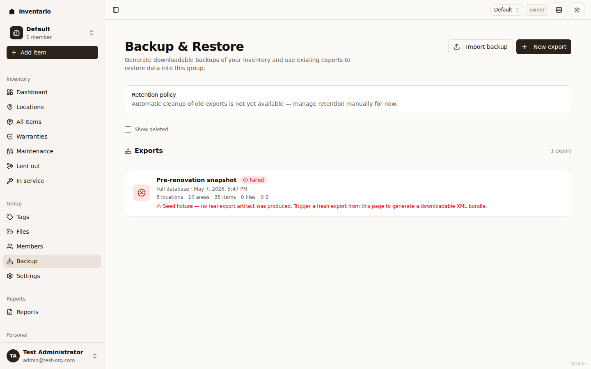

Inventario can package up your inventory into a downloadable backup so you always have your own copy — and bring that copy back later, whether to recover from a mistake or to move your data to another Inventario instance. Everything lives under **Backup** in the sidebar, on a page titled **Backup & Restore**.

This page covers creating an export, downloading it, importing a backup file, and restoring its contents into your group.

## Where to find it

Open **Backup** in the sidebar. The page lists every export that belongs to your current group, newest first, with a status badge on each one. While an export is still being built you'll see a small **Live** indicator next to the page title — the list refreshes itself, so you don't need to reload.

Two buttons sit at the top right:

- **New export** — build a fresh backup of your data.
- **Import backup** — upload an `.inb` file you saved earlier.

:::note
Exports belong to a [group](../groups-and-sharing/). What you back up and restore is always the inventory of the group you're currently in.
:::

## The .inb backup format

Backups download as `.inb` files — Inventario's own signed backup format. The file bundles your inventory data (and, if you choose, the attached file data itself) into a single archive that the server signs when it's created.

Because the file is signed, Inventario can verify it hasn't been tampered with or corrupted before it restores anything. You don't need to do anything special to benefit from this — it happens automatically when you import and restore.

A backup keeps an unknown price or purchase date unknown and a zero price zero, and a restore brings them back the same way (see [Unknown is not zero](../items/#unknown-is-not-zero)). A backup made by Inventario 0.2 or earlier has no unknown prices: there, a missing original price restores as **0**, and a missing current value or converted price restores as unknown. The other way round does not work: a backup made by this version restores only into this version or a later one, and Inventario 0.2 refuses it.

:::caution
`.inb` is the format Inventario reads back, so keep the file as-is. It isn't a spreadsheet or a zip you're meant to open and edit by hand.
:::

## Create an export

1. Go to **Backup** and click **New export**.
2. On the **What to export** step, choose a scope:
   - **Full database** — everything except what is in the [Trash](../trash/): locations, areas, items, files, tags, sellers, item types, custom fields. "Files" here means *all* of them — the photos, invoices and manuals attached to an item, the files attached to a location or an area, and any standalone file that isn't attached to anything. It also includes the [drafts of new items](../items/#drafts-of-a-new-item) and the files saved with them, and the record of the [documents other systems sent](../documents-from-other-systems/). It does not include the batches of [files added for the AI scan](../items/#add-items-from-files), which are a work queue: the drafts made from them are in the backup, and a dropped file that nothing else uses is exported as a standalone file.
   - **Selected items** — pick specific locations, areas, or items to include. Use the search box to find locations, then choose what to add. You have to pick at least one thing. The sellers and item types of the included items come with them, and so do the custom fields they have a value of. Files attached to a location or area you selected come with it; standalone files, drafts and the record of documents other systems sent are only included in a **Full database** export, since there's no parent to bring them along.
3. Decide whether to **Include attached files (photos, invoices, manuals)**. Despite the shorter label, this covers *every* file in scope — item attachments, files attached to a location or an area, and standalone files. Leave it on to bundle the actual files into the archive; turn it off for a smaller, metadata-only backup. A file attached to several items is stored in the archive once and comes back attached to each of them that the backup includes.
4. Click **Next** to reach the **Confirm** step. Optionally add a **Description** to help you recognise the export later. If you leave it blank, Inventario names it for you (for example, "Backup · Full database · 2026-05-13 10:42 UTC").
5. Review the summary and click **Create export**.

The export job runs in the background. Inventario takes you to the export's detail page, where the status badge updates on its own — **Pending**, then **In progress**, then **Completed**. The detail page also shows the scope, file size, attachments size, and counts of locations, areas, items, and files included.

## Download a backup

1. Open the export from the list (or stay on its detail page after creating it).
2. Once its status is **Completed**, click **Download**.

The browser saves a `.inb` file. Keep it somewhere safe — that file is your backup. **Download** stays disabled until the export has finished, and a backup can't be downloaded once it's been deleted.

:::tip
Storing your `.inb` files somewhere outside Inventario (a synced folder, an external drive) means you keep a copy even if you lose access to the app.
:::

## Import a backup file

If you have an `.inb` file from before — perhaps from another Inventario instance, or a download you saved — you can bring it back in.

1. Go to **Backup** and click **Import backup**.
2. Click the dropzone to choose a backup file. Only `.inb` files are accepted; anything else is rejected with "Choose a backup (.inb) file." A [personal data export](#a-backup-is-not-a-personal-data-export) is refused with its own message, even when renamed to `.inb`.
3. Optionally add a **Description** so you can find the import in the list later.
4. Click **Upload and continue**.

The file is staged on the server first and only inspected when you start the restore. After a successful upload, Inventario sends you straight to the restore form so you can finish the job. The imported export shows an **Imported** badge in the list and a note on its detail page.

:::caution[Backups stay with your group]
A backup restores only into the current group. Inventario confines an uploaded backup to the group that owns it — you can't import or restore someone else's backup into your group, and yours can't be pulled into theirs.
:::

### A backup is not a personal data export

**Download my data** in [Settings & account](../settings-and-account/#download-my-data) gives each person a copy of their own data: their profile, and in every group they belong to, the items, files and records they created. A group backup is the other way round: it holds the whole group, whoever created each part of it, and only for that one group.

| | Group backup | Personal data export |
| --- | --- | --- |
| Holds | Everything in one group | One person's data across all their groups |
| Made from | **Backup** in the group | **Preferences → Account**, by each person for themselves |
| File | Signed `.inb` | `.tar.gz` of JSON files |
| Kept | Until you delete it | 7 days |
| Restores | Into the group | Never |

Use a backup to keep or move a group. Use the personal data export to see or take away what you put into Inventario.

## Restore a backup

Restoring brings the contents of an export into your **current group**. Open an export and click **Restore** (the import flow drops you here automatically), then choose your options.

### Pick a strategy

| Strategy | Risk | What it does |
| --- | --- | --- |
| **Merge add** | Safe | Inserts new rows; existing rows are kept untouched. |
| **Merge update** | Moderate | Inserts new rows and updates existing ones in place. |
| **Full replace** | Destructive | Wipes existing data in the destination scope before importing. |

Restored items keep their [asset IDs](../items/#asset-ids-and-qr-labels), so
labels printed before the backup still match. If an item's number is already
taken in your group, for example by a different item during a merge, the restored
item gets a new number after the highest one in the group.

The two merge strategies skip an item or file from the backup that is in your
[Trash](../trash/): it stays in the trash, and you restore it from the Trash page.
A file from the backup that your group no longer has and that is attached only to
items in your trash goes to the trash with them, so restoring the item brings it
back.

**Full replace** removes your current data before importing, including everything in the [Trash](../trash/), so Inventario shows a clear warning before you run it. Use it only when you really want the backup to become the source of truth. It really does mean *everything*: items with no area assigned, files attached to a location or area, and standalone files are all wiped and then restored from the backup. The same goes for [drafts of new items](../items/#drafts-of-a-new-item): the group's drafts are replaced with the ones in the backup. Batches of files [added from files](../items/#add-items-from-files) are removed and not restored, since backups do not carry them. The record of the documents other systems sent is replaced with the one in the backup, see [Documents from other systems](#documents-from-other-systems).

### Drafts

A restore brings back the [drafts of new items](../items/#drafts-of-a-new-item)
in the backup with the files saved with them, linked to the restored area and
seller. A draft's item type is matched to your group's types
[the same way an item's is](#item-types). The two merge strategies keep a draft your group already has (the same
draft, saved again since the backup, for example) and say so in the restore
log; a file that only such a draft used comes back as a standalone file. So do
the files of a draft that cannot be restored, which the restore log counts as
an error. A backup made before drafts were included has none, so a merge
leaves your drafts as they are.

### Documents from other systems

Inventario remembers each document [another system sent](../documents-from-other-systems/),
so that sending it again makes no second draft. A restore brings that record
back, linked to the restored draft or item, so a document sent again after the
restore still makes nothing. A document whose draft or item the backup does
not bring back stays known, and sending it again still makes nothing.

The two merge strategies keep the record your group already has for a
document and say so in the restore log. **Full replace** replaces the group's
record with the backup's, so after restoring a backup that has none, for
example one made before Inventario kept it, a document sent again makes a new
draft. A dry run writes no record.

### Sellers

A restore links each item to the group's [seller](../sellers/) with the same
name, ignoring case and extra spaces, and creates the sellers the group does
not have. A seller that already exists keeps its website, contact, and note,
whichever strategy you pick, and **Full replace** does not remove sellers. A
dry run creates no sellers.

### Item types

A restore gives each item the group's [item type](../item-types/) with the same
internal key, so built-in types and types restored before match at once. A type
the group does not have under that key is matched by name, ignoring case and
extra spaces, and created when no type has that name either. A type that
already exists keeps its name and icon, whichever strategy you pick, and
**Full replace** does not remove item types. A dry run creates no item types.

A backup made by this version remembers which types and fields the
[Collection set](../groups-and-sharing/#add-the-collection-set) created. A
restore applies that only to the types and fields it creates, so removing the
set afterwards deletes those as if the set had just added them. A type or field
the restore matches to one the group already has stays as it was: if it is the
group's own, removing the set keeps it. A backup made before the Collection set
existed restores all of them as the group's own.

As without a restore, removing the set deletes only what the confirmation
lists and no saved item uses, counting items in the [Trash](../trash/), and it
keeps the group's last item type even when nothing uses it. It does not count
[drafts](../items/#save-as-draft): a type or field that only a draft uses is
deleted, and the draft still refers to it
([#2939](https://github.com/denisvmedia/inventario/issues/2939)). Finish or
check the drafts that use the set's types and fields before you remove it.

### Custom fields

A restore matches each custom field to the group's field it was backed up
from, even when that field was renamed since, and otherwise to the group's
field with the same name, ignoring case and extra spaces. It creates the fields
the group does not have, with their options and the item types whose form
shows them. A field that already exists keeps its name and its item types. A
select field keeps its options and gets the backup's options it lacks. An
option is matched the same way as a field, first to the option it was backed
up from and then by label, so an option renamed since the backup still holds
its values. When the group has a field of that name with a different
type, the backup's values of that field are left out and the restore reports
an error for it. The same happens when the field of that name is another field
of the backup, renamed since: for example, after you delete "Model code" and
rename "Serial" to "Model code", the backup's "Serial" values go to the renamed
field and its "Model code" values are left out.

A link to another item is restored when the linked item is in the backup or in
the group, outside the Trash. A backup keeps a link to an item in the Trash,
and a restore that cannot set a link reports an error for it. An item that
already holds the link keeps it, without an error, while the linked item is
still in the group's Trash. **Full replace**
does not remove custom fields. A dry run creates no custom fields, but reports
an error for each field the restore would refuse.

### Other options

- **Restore attached files** — restore the actual files alongside the metadata: an item's photos, invoices and manuals, the files attached to a location or area, and standalone files. Turn it off to restore only the records. (This only has files to restore if the export was created with attachments included.)
- **Dry run** — on by default. A dry run previews exactly what *would* change without modifying any data. Always worth running first.
- **Description** — required. It's useful when you're comparing several dry-run reports.

### Run it

1. Choose your **Strategy**, decide on **Restore attached files**, and leave **Dry run** on for your first pass.
2. Type a **Description**.
3. Click **Preview restore** (when Dry run is on) or **Restore now** (when it's off).

:::tip
A dry run never touches your live data, so make a habit of previewing first, reading the report, and only then turning **Dry run** off to run the real restore.
:::

## Read the restore report

Every restore — dry run or real — produces a step-by-step log. It opens automatically when the run finishes, and you can reopen it later from the **Restore history** on the export's detail page (**View log**).

The log walks through each step with a result marker so you can see what was created, updated, or skipped, and it flags anything that errored. For a dry run the header reminds you that **No changes were made**; for a real restore it confirms the operation finished.

An item the restore cannot bring back, for example one edited by hand in the
backup file, counts as an error, and the rest of the restore goes on. A file
that item shared with other items still comes back with them. A file that only
such items used is left out and counts as an error too.

## Manage and delete exports

- Every export you create or import appears in the **Backup** list with its status, scope, and size.
- To remove one, open it and use the delete (trash) action, then confirm. The export is removed and its stored file is deleted — this can't be undone, and you can't delete an export while it still has a restore running.
- Deleted exports are hidden by default. Tick **Show deleted** on the list to see them.

:::note
Inventario doesn't yet clean up old exports for you — the page notes that automatic retention isn't available, so trim old backups yourself when you no longer need them.
:::

## Related

- [Items](../items/) — what gets backed up and restored.
- [Files & photos](../files-and-photos/) — the attachments an export can include.
- [Locations & areas](../locations-and-areas/) — the structure your inventory lives in.
- [Groups & sharing](../groups-and-sharing/) — backups are scoped to a group.
- [Settings & account](../settings-and-account/) — your account and preferences.
