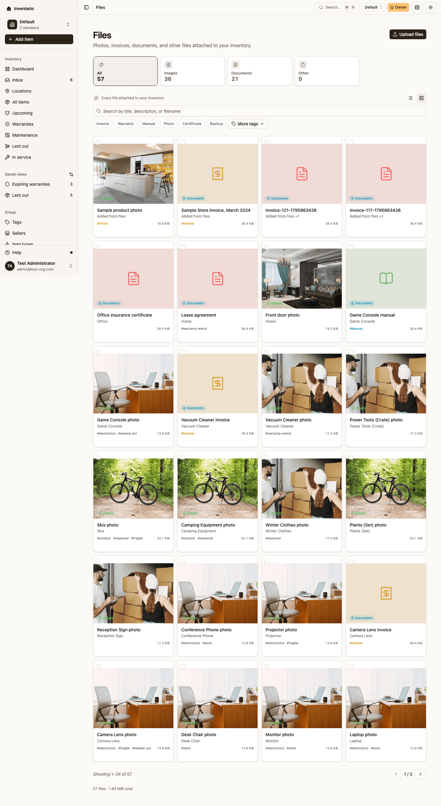
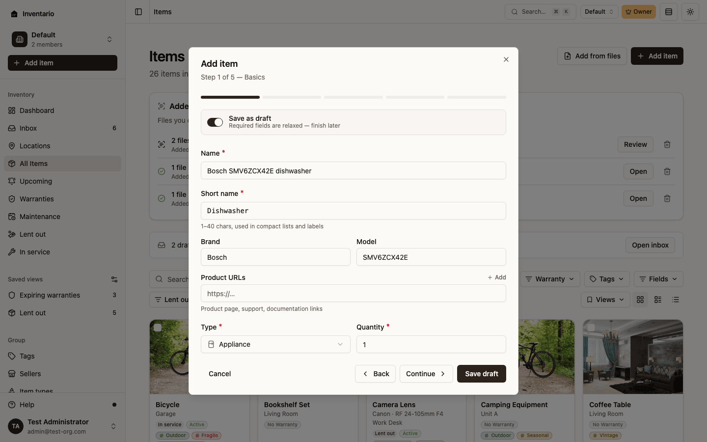
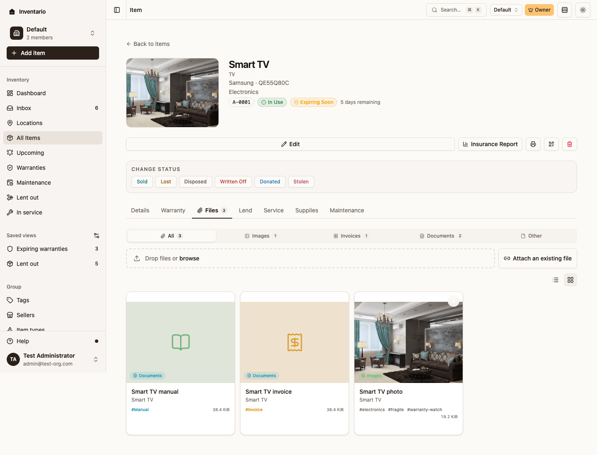
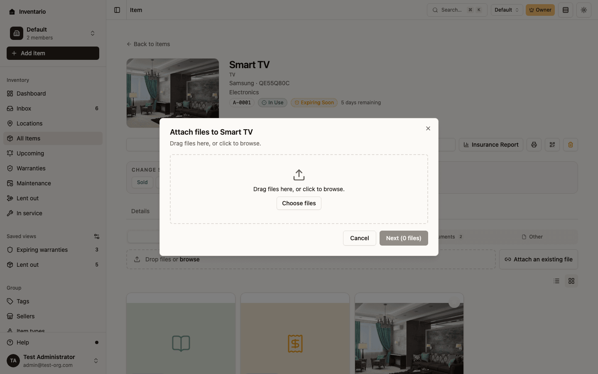
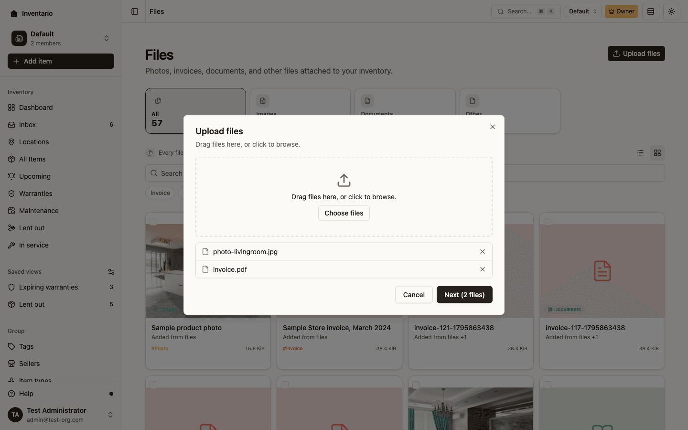

Almost everything you own comes with paperwork: a receipt, a manual, a warranty
certificate — plus the photos you take of the thing itself. Inventario lets you
attach all of it to your [items](../items/), browse it in one place, set a cover
photo, read PDFs and zoom into images right in the app, and even let AI read a
photo or receipt to fill in a new item for you. This page walks through each of
those.

## Attach files to an item

You can attach files — photos, receipts, manuals, warranty certificates,
anything — and there are a few places to do it.

**While adding an item**, use the **Files** step in the Add item dialog. Drop
files onto the dropzone or click it to browse. Each file gets a title, which
starts as the file name without its extension, and optional tags. **Add item**
uploads the files before it creates the item and shows how each upload goes;
if one fails, the item is not created until **Retry** uploads it. See
[Files](../items/#files) on the Items page.

**From an existing item**, open it and go to its **Files** tab. The tab has a
dashed upload zone — click it (or the **Browse** link inside it) to open the
upload dialog, or just drag files anywhere onto the item page to drop them in.

**From a location or area**, open it and use its **Files** panel — same idea,
with an **Attach files** button.

### Attach a file you already have

One file can be attached to several items, locations, and areas: a receipt for
three things bought together, a manual shared by every unit of the same model.
Upload it once, then attach it wherever it belongs:

- On an item's **Files** tab, click **Attach an existing file** next to the
  upload zone.
- On a location's or area's **Files** panel, click **Attach existing**.

A dialog lists the files in your group. Search by title, description, or
filename, and click **Attach** next to the file you want. Files already attached
here show **Attached** instead. The dialog stays open, so you can attach several
files in a row; click **Done** when you are finished.

Attaching does not copy anything. It stays one file wherever it is attached:
edit its title or tags once and every place shows the change, and it counts
toward your group's storage once.

The upload dialog itself runs in three quick steps:

1. **Select** — drop files on the dropzone or click **Choose files**. Add as
   many as you like; remove any you didn't mean to with the **×** next to it.
   Click **Next**.
2. **Adjust** — for each file you can edit the **Title**, pick a **Category**
   (**Images**, **Documents**, or **Other**), and add **Tags**. Inventario
   pre-fills the title from the filename and guesses the category from the file
   type, so you can usually skip straight ahead.
3. **Progress** — a progress bar tracks each file. When everything finishes,
   click **Close**.

If your group already holds a file with exactly the same content, the progress
row says so and names it. Click **Attach the existing file instead** to attach
that file and drop the copy you just uploaded, or **Keep both** to keep the new
copy. When you upload from the Files page, where there is nothing to attach to,
the first button reads **Remove this copy**.

Files are always optional. If you skip them while creating an item, you can add
them at any time from the item's **Files** tab.

:::tip
Attach files from *inside* the item, location, or area so they're linked to it.
Files uploaded from the global Files page (below) aren't attached to anything in
particular until you attach them with **Attach an existing file**.
:::

## The Files page

The **Files** section in the sidebar shows every file in your group in one
place. From here you can:

- **Switch between grid and list** with the view toggle. The grid shows
  thumbnails; the list shows a compact table with name, category, size, and
  upload date. Your choice is remembered.
- **Search** by title, description, or filename.
- **Filter** by category and by tag (see the next section).
- **Upload** with the **Upload files** button — this opens the same upload
  dialog described above.

Selecting a file opens its **details** panel on the right. The list keeps its
search, filters, and page behind the panel, so closing the panel puts you back
where you were. Tick the checkboxes on the cards (or the list rows) to select
several at once — a bar appears letting you **Move to…** a different category,
change their **Tags…**, or **Delete selected**.

**Tags…** opens two tag lists: under **Add tags**, pick tags or type a new one
to put on every selected file; under **Remove tags**, pick tags to take off.
Tags you pick in neither list stay on each file as they are. Files whose tags
could not be changed stay selected, so you can open **Tags…** again to retry
just those. When no file changed, a message says why: the files already had the
tags you added, or none of them had the tags you removed.

Files are sent in batches of 100. If a batch gets no answer, or fails on the
server, the message says how many files may have changed; they stay selected,
so check them before you send the change again. This holds for the first
batch too, and for 100 files or fewer, which go in one batch.

## Categories and filters

Every file lives in one of three categories, and Inventario sorts each file
into one automatically based on its type:

| Category | What goes here |
| --- | --- |
| **Images** | Item photos — shown on cards and in galleries. |
| **Documents** | Receipts, manuals, warranties, certificates. |
| **Other** | Backups and miscellaneous files. |

At the top of the Files page, category tiles (with **All** for everything) show
a live count for each category — click one to filter to it. Below the search box
is a row of tag pills (**Invoice**, **Warranty**, **Manual**, **Certificate**,
and so on); click any of them to narrow the list to files carrying that tag, and
**Clear all** to reset. **More tags** opens a searchable list of every file tag
in the group, for tags that have no pill of their own. You can change a file's category later — either from its
detail panel (via **Edit metadata**) or by selecting files and using
**Move to…**.

On an item's **Files** tab the filters look a little different: a row of chips
(**All**, **Images**, **Invoices**, **Documents**, **Other**) lets you jump
between just that item's attachments, with a count on each.

:::note
For more on labelling files so the tag pills above can find them, see
[Tags](../tags/).
:::

## Set a cover photo

The cover photo is the image that represents an item on cards and in lists. It
only applies to items, and only to image files.

- By default, the **first photo** you attach to an item becomes its cover
  automatically.
- To choose a different one, open the item's **Files** tab in **grid** view and
  hover a photo. A star button appears in the corner:
  - Click the outline star to **Set as cover** (or **Pin as cover** to lock in
    the current auto-pick).
  - The current cover shows a filled star — click it again to **Clear cover**
    and fall back to the automatic pick.
- You can also tick **Use as cover photo** on a photo in the upload dialog's
  **Adjust** step while attaching it to an item.
- A photo attached to several items can be the cover of each of them. Removing
  the photo's attachment to one item clears that item's cover choice only.

:::note
The star only shows in grid view, and only on photos.
:::

## View images and PDFs

Open any file from the Files page or an item's **Files** tab to see its details
panel, which includes an inline preview for images and PDFs. From there you can
expand to a full-screen viewer.

### Images

Click an image preview (or the expand icon) to open the full-screen viewer:

- **Zoom** with the **+** / **−** buttons, the mouse wheel, or the `+` / `−`
  keys.
- **Pan** by clicking and dragging.
- **Reset zoom** with the reset button or the `0` key.
- **Fullscreen** fills your whole screen.
- When you opened the image from a list of photos, **←** / **→** (or the
  on-screen arrows) step through the other images in that view, with a position
  counter (for example, "2 / 7").
- Close with the **×** button or `Esc`.

### PDFs

PDFs preview inline too, and expand to a full reader with:

- A **page thumbnail** rail you can toggle, plus previous/next page buttons and
  a page-number box to jump straight to a page.
- **Zoom** in and out, plus **Fit to width** / **Fit to page**.
- A switch between **continuous scroll** and **single page** views.
- **Click-and-drag panning** when the page is bigger than the window.
- **Download** and **Close** buttons in the toolbar.

Files that aren't images or PDFs can't be previewed — the panel shows a "Preview
not available. Download to view." message, and you can open or download the file
from there.

## File details: edit, download, delete

The file details panel shows the filename, category, type, when it was uploaded,
any tags, and what the file is linked to. Tag chips are clickable — they take you
to the Files page filtered to that tag.

**Linked to** lists every item, location, and area the file is attached to. Each
name opens that page. A file saved with a
[draft of a new item](../items/#drafts-of-a-new-item) lists the draft as
**Draft:** and its name (just **Draft** when it has none); that link opens the
draft in the **Add item** dialog. The **×** next to a name removes that
attachment and nothing else: the file stays attached everywhere else, and once
nothing is left it stays on the Files page as **Not attached to anything**
until you delete it. A file you dropped for
[Add items from files](../items/#add-items-from-files) shows **Added from
files** while its batch holds it. That entry has no **×**: the file is released
when the batch is removed.

The action row gives you:

- **Open in new tab** — opens the file in your browser.
- **Download** — saves a copy.
- **Edit metadata** — opens the file's edit page, described below.
- **Delete file** — moves the file to the [Trash](../trash/) after a
  confirmation. The confirmation names every place the file is attached to,
  because it disappears from all of them.

:::note
A deleted file waits in the [Trash](../trash/) for 30 days, and restoring it
brings back its attachments. To take a file off one item only, remove that
attachment instead of deleting the file.
:::

Deleting an item moves the files attached only to it to the trash with it, and
restoring the item brings them back. A file that is also attached somewhere else
stays there. Deleting a location or an area removes its attachments: a file
attached only there is deleted with it.

### Edit a file's details

**Edit metadata** opens an edit page with the file's preview on the left and
its details on the right: **Title**, **Filename**, **Category**, **Description**,
and **Tags**. Only the details change; the file itself stays as it is. On a
narrow screen the preview and the details are two tabs, **Preview** and
**Details**, and switching between them keeps what you have typed.

**Save changes** saves and takes you back to where you opened the file from.
**Cancel** goes back without saving.

When you open the edit page from the Files page, it keeps the list you came
from, with its search, category, tag filter, and page. This makes it quick to
go through a batch of uploads one after another:

- The header shows the file's place in that list (for example, "3 of 12") and
  arrows to the previous and next file.
- **Save and next** saves the file and opens the next one in the list. It moves
  on to the list's next page when needed.
- **Back to files**, **Save changes**, and **Cancel** take you back to that list,
  on the page you reached, with the file's details panel open.

**Save and next** opens the file that came after this one when you saved, even
if your edit takes this file out of the list, for example because you removed
the tag the list is filtered by. When the file on screen is not in the list's
current results, such as a file you go back to after removing that tag, the
page says "This file is not in the list's current results." under the header.

If you try to leave the page with unsaved changes, Inventario asks whether to
**Save** them, **Discard** them, or **Keep editing**. Reloading or closing the
tab asks your browser to confirm.

:::caution
The browser's own **Back** button does not ask first. Unsaved changes are lost
if you use it.
:::

## Scan an item from a photo or PDF with AI

If AI vision is enabled on your server, Inventario can read a photo or document
and pre-fill a new item for you. This is the **Fill with AI** option in the Add
item dialog.

1. Click **Add item**, then choose **Fill with AI**.
2. Drop in your files, or browse to pick them. Supported formats are **JPG,
   PNG, WEBP, HEIC/HEIF, or PDF** — up to **5 files** at a time. A clear photo
   of the item plus its label (the plate with model and serial numbers) works
   well, and so does a receipt or invoice PDF.
3. Click **Scan files**. AI reads them — you can **Cancel** while it works.
4. On **Review extracted details**, each field (name, brand, model, type,
   price, serial number, purchase date, seller, warranty expiry, tags, and more) shows
   what AI found, with a confidence label. Untick anything that looks wrong.
   A field you already filled in shows your value next to the scan's and
   starts unticked, so the scan replaces it only if you tick it.
5. Click **Use these values** to pre-fill the form, then finish and save the
   item as usual.

A few things to know:

- The files you scanned are **attached to the item automatically** — photos go
  to **Images**, PDFs to **Documents** — so you don't have to upload them again.
- If AI finds **more than one product** (for example, on a multi-item receipt),
  it asks you to **Choose which item to add** and pre-fills that one — you can
  add the others separately afterwards. To get a draft for every product on a
  receipt at once, use [Add items from files](../items/#add-items-from-files).
- Each scanned file also gets the tag of its kind (**Invoice**, **Manual**,
  **Warranty** or **Photo**) and a readable title from the scan. A file you
  renamed keeps its title, and a file you gave one of those four tags gets no
  other; any other tag you set does not stop the suggestion. In the Add item
  dialog they show on the
  **Files** step with a sparkle, and you can remove or change them there (see
  [Fill with AI](../items/#fill-with-ai)). A file you add with
  **Add items from files** gets them once it is scanned.
- When a receipt or invoice names the seller, the item names your group's
  seller with that name. If your group has no such seller, the **Purchase**
  step offers to create it; nothing is created until you agree (see
  [Sellers read by AI](../sellers/#sellers-read-by-ai)).
- If a price's currency isn't on the server's supported list, it won't be
  pre-filled, and the review step tells you so.
- Scanning is **rate-limited** to keep usage fair, so you may occasionally be
  asked to wait a moment before trying again.

:::note
If AI vision isn't enabled on your server, you'll see a message saying so — just
use **Fill manually** to continue. Whether AI vision is available depends on how
your server is configured (see [Self-hosting](../self-hosting/)).
:::

For more on creating items, see [Items](../items/); for organising your files
with labels, see [Tags](../tags/). To keep your files safe, see
[Backup and restore](../backup-and-restore/).
