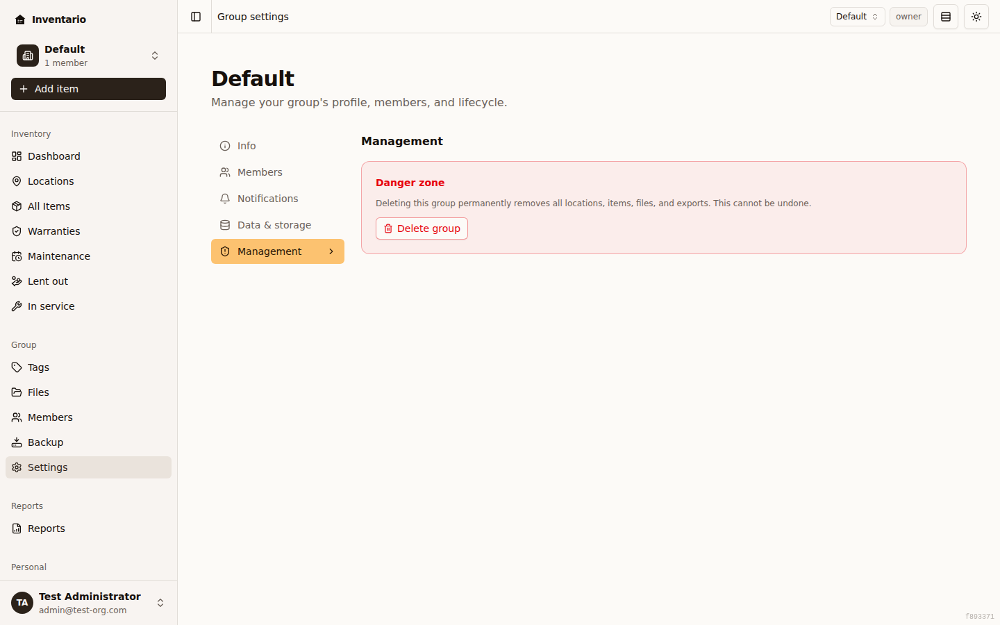

Inventario organises everything you track into **groups**. A group is a complete, self-contained inventory — its own [locations and areas](../locations-and-areas/), [items](../items/), [files](../files-and-photos/), [tags](../tags/), [sellers](../sellers/), [item types](../item-types/), and [backups](../backup-and-restore/). You can belong to several groups at once (your home, a holiday flat, a small business), switch between them whenever you like, and invite other people into any group with a role that decides what they can do.

## What a group is

Think of each group as a separate inventory that doesn't mix with your others. Items, locations, files, and tags all live inside one group — switching groups swaps the whole view in the app. The people you invite into a group only ever see that group's data, never your other groups.

The sidebar always shows which group you're currently working in. If you don't belong to any group yet, for example as the first administrator of a new server, the app opens a welcome page that asks you to create one.

## Create a group

You can create as many groups as you need.

1. Open the group selector at the top of the sidebar (it shows the current group's name and member count).
2. Choose **Create new group**.
3. On the **Create a new group** page, fill in:
   - **Group name** — for example "Main residence".
   - **Icon** — optional; pick something to make the group easier to recognise in the sidebar.
   - **Group currency** — the currency this inventory's prices are tracked in (see [The group currency](#the-group-currency)).
   - **What is the group for?** — **Household items** (the default) or **Collection**. A **Collection** group starts with the [Collection set](#add-the-collection-set) of item types and custom fields and with the **Warranties** section [hidden](#hide-sections-the-group-doesnt-use). You can change both later in the group settings.
4. Click **Create group**. The new group opens straight away and becomes your active group. If it is your first group, the [product tour](../getting-started/) starts and shows you around the sidebar.

If the group is created but the Collection set could not be added, a message says so. The group is there; open **Group settings → Sections** and click **Add the set**, or **Add what is missing** if part of it is there, to finish it.

## The group currency

Every group has one **group currency** — the currency all of its item prices and totals are shown in. You choose it when you create the group, using a 3-letter ISO code (for example **USD**, **EUR**, or **CZK**).

:::caution[Set once at creation]
The group currency is fixed when you create the group. To change it later you'd use the currency-migration tool in **Group settings → Info**, which reprices every item in the group at an exchange rate you provide. That tool is only available if your server operator has enabled it; if it's switched off you'll see a note saying so.
:::

Once a currency migration of the group has started, **Group settings → Info** has a link to the group's migrations: the latest ten, newest first, each with its currencies, rate and status. A migration drops off that list 90 days after it ended, unless your server operator set another period.

## Switch the active group

The active group decides what the whole app shows you.

1. Open the group selector at the top of the sidebar.
2. Pick the group you want from the list. A check mark shows which one is currently active.

The app switches to that group immediately.

:::tip
You can keep two browser tabs open on two different groups — they stay independent of each other. The same dropdown also has shortcuts to **Group settings** (for the current group) and **Create new group**.
:::

## Hide sections the group doesn't use

Not every inventory needs every part of Inventario: a group for a book collection has no warranties to watch, for example. An administrator or owner can hide these sections for everyone in the group:

| Section | What hiding it removes |
| --- | --- |
| **Warranties** | The **Warranties** page, the warranty cards on the Dashboard, the warranty counts on area and location pages, the **Warranty** step of the item form, and warranty reminder emails. |
| **Maintenance and repairs** | The **Maintenance** and **In service** pages, adding a schedule or sending an item for service, and maintenance reminder emails. |
| **Loans** | The **Lent out** page, lending an item out, and loan reminder emails. |
| **Upcoming** | The **Upcoming** page. |

To hide a section or show it again:

1. Open the group selector and choose **Group settings**, then open the **Sections** section.
2. Switch a section off to hide it, or on to show it. The change applies at once, for every member.

Members with the **User** or **Viewer** role see the same switches but can't change them.

Hiding a section keeps its data. An item that already has a warranty date, a loan, or a maintenance schedule still shows it on its page, and the item form keeps the **Warranty** step for an item that has a warranty. You can still mark a loan returned or a task done; you can't start a new loan, schedule, or service visit until the section shows again. While a section is hidden, its reminder emails stop and the [weekly digest](../settings-and-account/#weekly-digest) leaves its lines out. When you show it again, reminders pick up from the dates as they are then, as described in [Reminder emails](../warranties-loans-maintenance/#reminder-emails).

A link or a bookmark to a hidden page opens a notice that the section is hidden, with a link to the group settings.

## Add the Collection set

The **Collection set** fits a group that keeps a collection. Adding it creates these [item types](../item-types/):

**Art**, **Books**, **Coins**, **Stamps**, **Records**, **Watches**, and **Cards**

and these [custom fields](../custom-fields/), each offered on every one of those types:

| Field | Type |
| --- | --- |
| **Condition** | Select: Mint, Very good, Good, Fair, Poor |
| **Catalog reference** | Text, for a Krause, Scott, Discogs, or ISBN number and the like |
| **Edition or variant** | Text |
| **Signed** | Yes/no |
| **Provenance** | Long text |
| **Certificate of authenticity** | Yes/no |
| **Appraised value** | Money |
| **Appraisal date** | Date |

The item's own **Serial number** stays as it is. The types and fields are created with English names; rename them, change their icons, or add options like any type or field you made yourself.

To add the set:

1. Open the group selector and choose **Group settings**, then open the **Sections** section.
2. On the **Collection set** card, click **Add the set**.

If the group already has a type or field with one of these names, in any mix of upper- and lowercase, the set uses it instead of creating a second one: such a type gets the set's fields, and such a field is offered on the set's types. Adding the set again creates only what is missing, so if adding stopped partway, for example because the group reached its limit of [item types](../item-types/#add-a-type) or custom fields, the card shows **Partly added** and **Add what is missing** finishes it. While the group is still at that limit, **Add what is missing** cannot create what is missing either: delete types or fields the group no longer needs to make room first. The card also shows **Partly added** while one of the set's fields is not offered on every one of its types, for example when the group already had all of them under these names; **Add what is missing** then offers each field on each type.

The card names the state of each type and field: added by the set, the group's own, or not in the group. If you renamed one of the set's types or fields to the name of another one, for example **Coins** to **Stamps** after deleting **Stamps**, the card shows that name as not added: the renamed type or field stands for it, and adding the set does not create a second one of that name.

To remove the set, click **Remove the set** on the same card. The confirmation checks the group again when it opens, then lists what will be deleted and what stays, with the reason:

- a type or field the group had before the set, which the set never deletes;
- a type that items have, or a field that items have a value of, counting items in the [Trash](../trash/);
- the group's last item type, as a group always keeps one.

The check counts saved items only, not [drafts](../items/#save-as-draft): a type or field that only a draft uses is listed for deletion, and the draft still refers to it after the removal ([#2939](https://github.com/denisvmedia/inventario/issues/2939)). Finish or check such drafts before you remove the set.

Removing deletes only what the confirmation listed and leaves every item as it is. If something on the list comes into use before you confirm, for example because another member gives an item that type, it stays, and the message after removing names it. You can remove the set again later: it then deletes what has stopped being used since.

A type or field the group had before the set keeps what the set linked to it. Such a type still offers the set's fields that stay, and such a field is still offered on the set's types that stay and on the group's own types the set linked it to. To undo a link, untick the type under **Item types** in the field's dialog (see [Custom fields](../custom-fields/#offer-a-field-on-item-types)). While the set's types are in the group, the card then shows **Partly added**, and **Add what is missing** would put the link back.

Only an **Owner** or **Administrator** can add or remove the set. Other members see the card without the buttons. Each add and remove is recorded in the audit log of the server, with what it created or deleted. The people who run the server can read that log; group members don't see it.

## Failed background jobs

Some work runs in the background after you start it: an export or a restore, a thumbnail for an uploaded photo, a scan of the photos and files you [add from files](../items/#add-items-from-files) (the batches in the [Inbox](../inbox/)) or of a [document sent from another system](../documents-from-other-systems/), a currency migration. Thumbnails and scans are tried a few times on their own. When a job fails for good, it stops and waits for someone to look at it. Owners and administrators find these jobs in the group settings:

1. Open the group selector and choose **Group settings**, then open the **Data & storage** section.
2. The **Failed background jobs** card lists the jobs that stopped, newest first, each with its kind, its name, when it failed, how many attempts it made, and why it failed.
3. Click **Retry** to put a job back in its queue. It leaves the list; if it fails again, it comes back. Retrying a scan from its batch in the Inbox (**Retry unfinished**) does the same.

A restore and a currency migration can't be retried: a restore may have written part of the backup already, and a migration ran at the exchange rate you confirmed then. Their row tells you to start a new [restore](../backup-and-restore/) or currency migration instead, and that your server operator can remove the failed one from the list. A failed currency migration leaves the list on its own 90 days after it failed, unless your server operator set another period. A job that fails again and again usually needs your server operator, who sees the failed jobs of every group.

A photo whose thumbnail failed for good keeps its placeholder: opening it again does not start another try while the job is on the list. Thumbnail jobs are cleaned up after a day; after that, the next time the photo is shown it is tried again.

Members with the **User** or **Viewer** role don't see the card.

## Invite people by email

You invite people from the **Members** page. You need to be an **Owner** or **Administrator** of the group to send invites.

1. Open **Members** in the sidebar.
2. Click **Invite**.
3. In the **Invite to …** dialog, enter the person's **Email address**.
4. Choose a **Role** — **Viewer**, **User**, or **Administrator** (you can't invite someone straight in as Owner; see [Members and roles](#members-and-roles)).
5. Click **Send invite**. They'll receive an invite link by email.

### Copy-paste invite links

If you'd rather hand someone a link yourself instead of emailing it, choose **Or create a copy-paste invite link instead** in the invite dialog. Inventario generates a link you can copy and share however you like — by message, chat, or in person. Anyone who opens a valid link can use it to join the group with the role you picked.

## Members and roles

Each member of a group has one **role** that controls what they can do. The **Members** page shows everyone in the group with their role, and a **Role permissions** card explains each role. Members who have set a [profile photo](../settings-and-account/#profile-photo) appear with it; everyone else appears with their initials.

| Role | What they can do |
| --- | --- |
| **Owner** | Full access including deleting the group and all data. |
| **Administrator** | Can manage members, group info, locations and areas. |
| **User** | Can add and remove items (not locations or areas). |
| **Viewer** | Can view all items, but cannot make any changes. |

A group can have more than one owner. The **Members** page also shows quick stats at the top: total **Members**, **Admins & Owners**, and **Pending invites**.

Every member, viewers included, can keep personal [saved views](../items/#saved-views) of the item list. Sharing a view with the group takes the **User** role or higher, and administrators and owners can change or delete any shared view. A shared view shares the filter only: each member sees the items their own access allows. Sharing does not put the view in anyone's sidebar or on their Dashboard; each member decides that for themselves.

:::note
If you're a User or Viewer, you can see the member list but you won't see the invite, role-change, or remove controls — those are limited to admins and owners.
:::

## Change a member's role

You need to be an **Owner** or **Administrator**.

1. Open **Members** in the sidebar.
2. Find the member and open their actions menu (the **⋯** button on their row).
3. Under **Change role**, pick the new role.

A few rules apply:

- Only **owners** can promote someone to **Owner** or change another owner's role. Administrators can manage everyone except owners.
- You can't change your own role from this menu.
- You can't demote the **last owner**. Promote someone else to owner first, or [delete the group](#delete-a-group) instead. The app blocks this for you and explains why.

## Manage pending invites

Invites that haven't been accepted yet appear in the **Invite links** section of the **Members** page, each marked with a **Pending** badge. Owners and administrators can act on them via the **⋯** menu on each invite row:

- **Resend invite** — send the invite email again (available for email invites).
- **Copy** — copy the invite link to your clipboard so you can share it another way.
- **Revoke** — cancel the invite. The link stops working and the person can no longer use it to join.

Invites that have already been used can't be revoked.

## Leave a group

If you no longer want to be part of a group, you can leave it.

1. Open the group selector and choose **Group settings**, then open the **Members** section.
2. In the **Leave group** panel, click **Leave group**.

You'll lose access to all of that group's data, but you can be re-invited later.

:::caution[Last owner can't leave]
You can't leave a group if you're its **last owner** — that would strand the group with no one able to manage it. Promote another member to owner first, or delete the group. If you're the only member at all, delete the group instead of leaving.
:::

## Remove a member

Owners and administrators can remove other people from a group.

1. Open **Members** in the sidebar.
2. Open the **⋯** menu on the member's row and choose **Remove**.
3. Confirm in the dialog.

The person loses access to the group's data immediately, and you can re-invite them later. You can't remove the **last owner** (promote someone else first), and the menu doesn't offer a remove action on your own row — use [Leave a group](#leave-a-group) for that.

## Delete a group

Deleting a group is permanent and removes **all** of its locations, items, files, and exports. Only an **Owner** can do it.

1. Open the group selector and choose **Group settings**, then open the **Management** section.
2. Under **Danger zone**, click **Delete group**.
3. In the confirmation dialog, type the **group name** and your **current password**, then click **Delete permanently**.

The group name guards against an accidental click; your password protects against someone using a hijacked session.

Deletion starts as soon as you confirm. If another member saves the group settings at the same moment, their change is refused and the deletion goes ahead.

:::caution[No undo]
There's no way to recover a deleted group. If you might want the data later, create a [backup](../backup-and-restore/) first.
:::

## Related guides

- [Locations and areas](../locations-and-areas/) — organise where things live inside a group.
- [Settings and account](../settings-and-account/) — your personal preferences and profile.
- [Backup and restore](../backup-and-restore/) — export a group's data before big changes.
