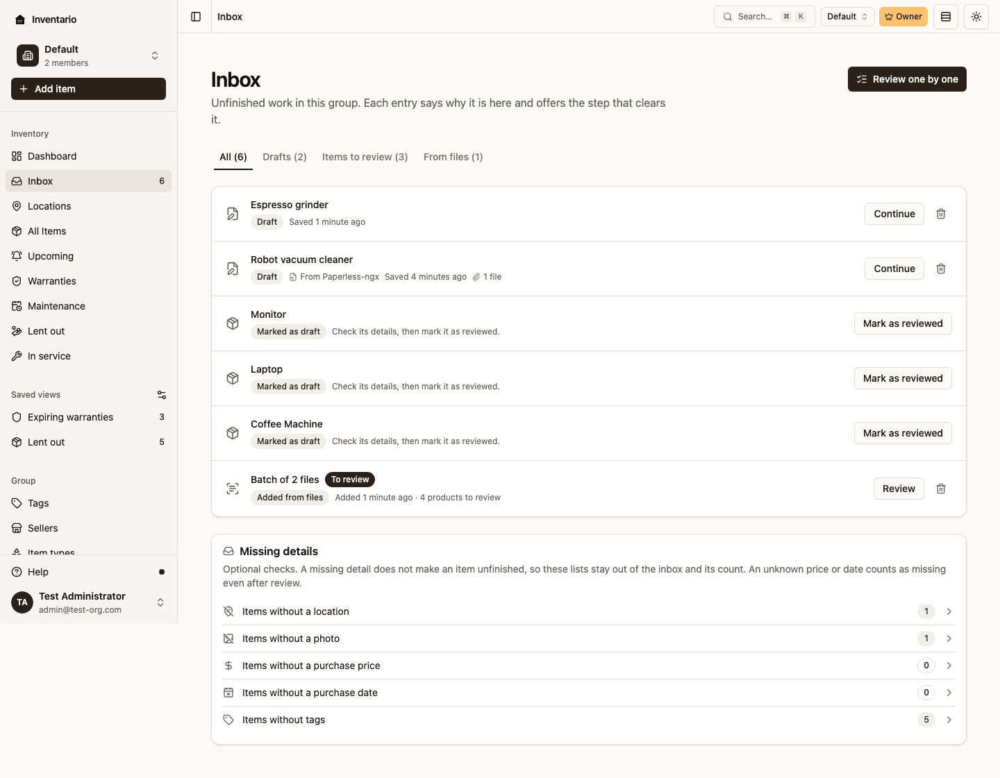
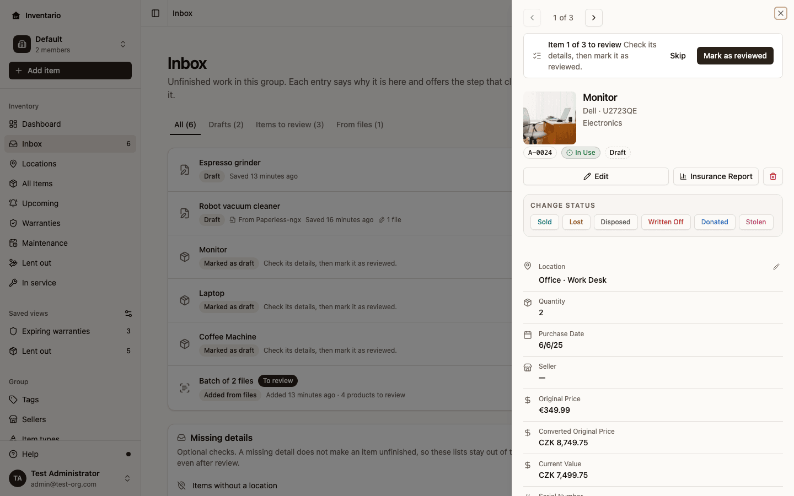

Items often get added in a hurry: a draft saved on the phone, an item marked
as a draft to check later, a pile of receipts added from files. The **Inbox**
collects this unfinished work in one list. Each row says why it is there and
offers the step that clears it.

Open **Inbox** from the second row of the **Inventory** section in the
sidebar. The number next to it is how many records in the group need
attention. Other places lead to the inbox too:

- The dashboard shows a **Needs attention** card with the same number and what
  it is made of, for example "2 drafts to finish · 1 item to review · 1 batch
  of files to finish". Click it to open the inbox.
- The **All Items** page shows a line with the drafts and the items to review
  and an **Open inbox** button. It leaves out the batches of files, which the
  page lists in its own **Added from files** card.

The card, the line and the number are hidden while there is nothing for them
to show. If the number cannot be loaded, the dashboard card says so, with
**Retry** and a link to the inbox.

## What is in the inbox

| Reason | What it is | What clears it |
| --- | --- | --- |
| **Draft** | A [draft of a new item](../items/#drafts-of-a-new-item), saved but not added as an item yet, or a draft made from a [document another system sent](../documents-from-other-systems/). | **Continue** and add the item, or **Discard**. |
| **Marked as draft** | An item whose **Save as draft** switch is on (see [Drafts of an existing item](../items/#drafts-of-an-existing-item)). | **Mark as reviewed**. |
| **Added from files** | A batch of files you [added from files](../items/#add-items-from-files) that is not finished: a file waits for its scan or could not be read, or a product waits for your decision or for its draft. | **Review** the batch and create the drafts, retry the files that failed, or remove the batch. |

The tabs above the list show all rows, only **Drafts**, only
**Items to review**, or only the batches **From files**, each with its count.
The number in the sidebar counts every record once, even one that is listed
for more than one reason.

The newest drafts come first, then the items, then the batches of files,
newest first. A long inbox is split into pages of 50 rows.

## Finish a draft

- **Continue** opens the draft in the **Add item** dialog on top of the inbox,
  with its values and files. The dialog opens on the first step that still
  needs input: the step with a field to correct, with that field marked, or
  else the step after the last one the draft has values on. The steps before it are one click away on
  the step bar or with **Back**. Add the item to finish it; the draft leaves
  the inbox. Close the dialog to come back to the inbox with the draft
  unchanged. The draft's files are on the **Files** step, where you can
  change their titles and tags, such as the ones a scan gave them (see
  [Files](../items/#files)).
- **Discard** deletes the draft after you confirm. Its files that nothing else
  uses go to the [Trash](../trash/).

See [Save as draft](../items/#save-as-draft) for how drafts are saved and
shared between devices.

A draft that another system sent, for example Paperless-ngx, says so in its
row, such as **From Paperless-ngx**, and links to the document there when the
system sent its address. See
[Documents from other systems](../documents-from-other-systems/).

## Review an item

An item marked as draft is hidden from **All Items** until **Show inactive**
is on, so the inbox is where you find it. Click its name to open it on top of
the inbox and check its details.

**Mark as reviewed** turns the item's **Save as draft** switch off, and the
item leaves the inbox. The message at the bottom of the screen has an **Undo**
button that marks it as draft again.

Marking an item as reviewed needs the item to be complete: if something is
missing, for example a price in another currency without an amount in the
group currency, the item stays in the inbox and the message says what to fix,
with an **Open item** button. An unknown purchase date or price is fine: a
reviewed item can keep them unknown, and it does not come back to the inbox
for them.

## Review the items one by one

**Review one by one**, at the top of the inbox, opens the first item to
review. An item opened from the inbox shows a review bar with its place in
the list, for example "Item 1 of 4 to review":

- **Mark as reviewed** marks the item as reviewed, as on the inbox row, and
  opens the next item still waiting for review. After the last one, you are
  back in the inbox.
- **Skip** opens the next item and leaves this one in the inbox.

Edit the item on its page as usual in between: the fields of the **Details**
tab, or **Edit** for the whole form. **Mark as reviewed** waits while a field
of the **Details** tab is open or being saved; save or cancel it first. If you
open a field, a dialog or a confirmation on the item, in any of its tabs,
before the next item opens, you stay on the item. Marking an item as reviewed changes nothing else
on it. **Previous** and **Next** at the top, and **Save and next** in the edit
form, move through the same list (see
[Go through a list one item at a time](../items/#go-through-a-list-one-item-at-a-time)).
**Back to inbox** returns to the inbox.

## Finish a batch of files

A batch row shows how many files the batch has, its state (**Scanning**,
**To review** or **Done**), when it was added and how far it got, for example
"1 of 3 scanned" or "2 products to review". While its files are being scanned,
the row updates by itself.

- **Review** opens the batch's review page (see
  [Review a batch](../items/#review-a-batch)), where you keep the products you
  want and create their drafts. The button reads **Open** while files are still
  being scanned, for a batch whose only work left is a file that could not be
  read, and for members who can only view.
- The trash button removes the batch after you confirm. Drafts made from it
  stay; its files that nothing else uses go to the [Trash](../trash/). A batch
  cannot be removed while its files are being scanned.

The batch leaves the inbox once every file is scanned and every product has a
draft or is left out. A file that could not be read keeps the batch here until
you retry it with **Retry unfinished** on the review page or remove the batch,
so a failed scan is not forgotten.

## Missing details

An item that lacks a detail is not unfinished, so it is not in the inbox and
not in its count. The **Missing details** section under the list shows how
many items lack each detail and opens **All Items** with the matching filter:

- **Items without a location** turns on the **No location** filter.
- **Items without a photo**, **Items without a purchase price**, and **Items
  without a purchase date** turn on the matching choice of the **Missing**
  filter.
- **Items without tags** shows the untagged items.

The counts cover the items that **All Items** shows by default: items in use
that are not marked as draft. Items marked as draft are in the inbox list
instead. An unknown purchase price or date counts as missing even after you
reviewed the item with it unknown: reviewing says the item is done, and these
lists stay available for the details you may still want to fill in. A price of
0 is a price.

You can [save any of these lists as a view](../items/#saved-views) to keep it
one click away.

## Who can do what

Everyone in the group sees the same inbox. Members with the **Viewer** role
see the rows but cannot continue, discard, or review them, or remove a batch,
and do not get the review bar. They can open a batch to see it.
