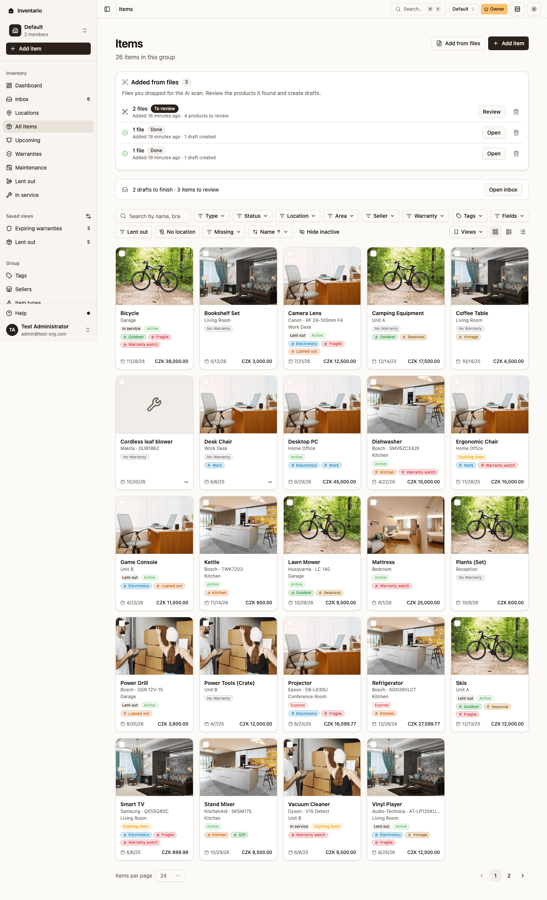
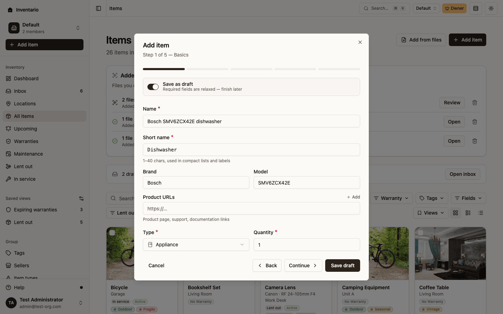
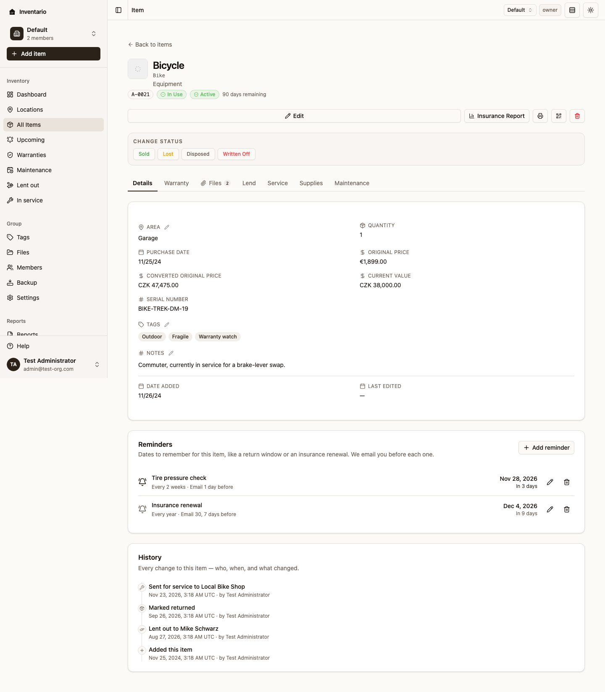
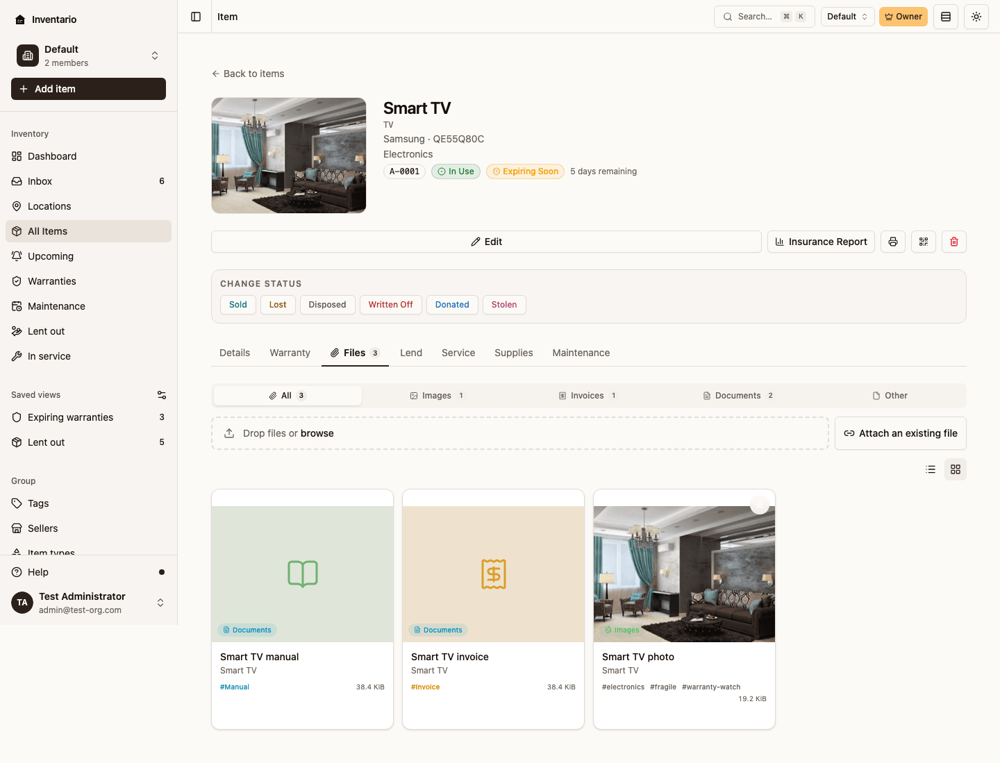
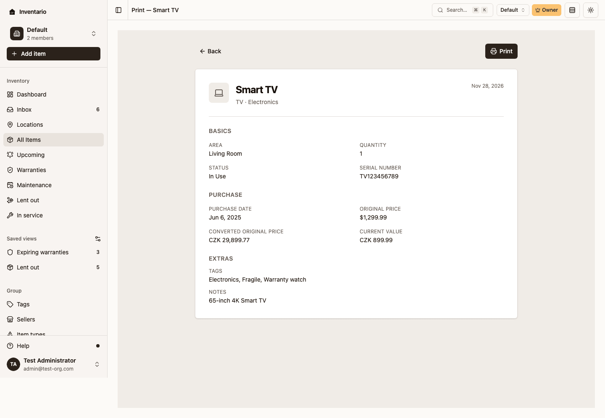

An **item** is anything you want to keep track of — an appliance, a laptop, a
piece of furniture, a tool. This page covers everything about items: adding
them (manually or with AI), every field on the form, the item detail page and
its tabs, editing an item, the status lifecycle, prices and currencies, the cover photo, and
how to find, sort, and bulk-edit items on the **All Items** page.

## Add an item

1. Click **Add item** (the button is on the Dashboard and on the **All Items**
   page).
2. The **Add item** dialog opens. If AI scanning is enabled on your server, it
   starts on the **Fill with AI** screen; otherwise it opens straight on the
   form.
3. Choose how to start:
   - **Fill with AI** — drop in a photo or a receipt/invoice PDF and let AI
     pre-fill the form (see [The Add item dialog, step by step](#the-add-item-dialog-step-by-step)).
   - **Fill manually** — type the details yourself.
4. Work through the steps and click **Add item** on the last step to save. Your
   new item opens so you can review it.

:::tip
Items don't have to be placed in a location to be saved. If you skip the area,
the item shows a small banner offering to **Place in location** — do that
whenever you like, or leave it unassigned. See
[Locations & areas](../locations-and-areas/).
:::

## The Add item dialog, step by step

The dialog has five numbered steps, shown as a segmented progress bar at the
top: **Basics → Purchase → Warranty → Extras → Files**. Use **Continue** and
**Back** to move between them, or click a segment you've already visited to jump
straight to it.

The same dialog edits an existing item when you click **All fields** on the
item's edit form (see [Edit an item](#edit-an-item)). Its title then reads
**Edit item**, every segment can be clicked from the start, and **Save changes**
is on every step, so you can change one field and save without going through
the rest.

### Fill with AI

If AI vision is enabled on your server:

1. On the **Fill with AI** screen, drop in your files or click to browse.
   Supported formats: **JPG, PNG, WEBP, HEIC/HEIF or PDF — up to 5 files**. A
   clear photo of the item plus its label, or a receipt/invoice PDF, works
   best.
2. Click **Scan files**. AI reads them and, on the **Review extracted details**
   step, shows each value it found with a confidence indicator.
3. Untick anything that looks wrong, then click **Use these values** to
   pre-fill the form.
4. The files you scanned are attached to the item automatically — manage them
   on the **Files** step.

A few things to know:

- If AI finds more than one product, it pre-fills the most prominent one and
  lets you add the others separately afterwards.
- If AI vision isn't enabled, you'll see a message saying so — click **Fill
  manually** to continue.
- Scanning is rate-limited, so you may occasionally be asked to wait a moment.

See [Files & photos](../files-and-photos/) for more on attachments.

## All the fields

The form is split across the five steps. Only a handful of fields are required
(marked with an asterisk in the app).

### Basics

| Field | Notes |
| --- | --- |
| **Name** * | The full name, e.g. "Bosch SMV6ZCX42E dishwasher". |
| **Short name** * | A 1–40 character label used in compact lists. On a new item it follows the name as you type, cut to whole words of up to 20 characters, until you type a short name of your own. |
| **Brand** | Who made it, e.g. "Bosch". Up to 100 characters. As you type, the brands already used in your group are suggested, most used first; pick one with a click or with the arrow keys and Enter. |
| **Model** | The model name or number, e.g. "SMV6ZCX42E". Up to 100 characters. Compact cards, list rows, and the item page show "Brand · Model" under the item's name; an item with neither shows its short name there. Photo cards show "Brand · Model" under the name when the item has either. |
| **Product URLs** | Links to the product page, support, or docs. Add as many as you like. |
| **Type** * | **Appliance**, **Electronics**, **Equipment**, **Furniture**, **Clothes**, or **Other**. |
| **Quantity** * | How many you own (see [Quantity and bundles](#quantity-and-bundles)). |
| **Location** / **Area** | Only when you edit an item; a new item is placed after it is saved. Where the item lives: pick a location first, then an area. Both are optional. Owners and administrators can also add a new location or area from the pickers. See [Locations & areas](../locations-and-areas/). |
| **Status** * | Starts as **In Use** (see [Status lifecycle](#status-lifecycle)). |

### Purchase

| Field | Notes |
| --- | --- |
| **Purchase date** | When you bought it. Can't be in the future. Leave it blank if you don't know it. |
| **Seller** | The shop or person you bought it from, picked from your group's [sellers](../sellers/). Choose **New seller** at the end of the list to add one without leaving the form. |
| **Original price** | What you paid, in the original purchase currency. Leave it blank if you don't know it; enter **0** if it was free. |
| **Current value** | Current resale / insurance value, in the group currency. Leave it blank if you don't know it. |
| **Serial number** | Found on the device label or packaging. |

If the original price is in a different currency from your group, an extra field
appears for the **converted purchase price** in the group currency — see
[Prices and currencies](#prices-and-currencies).

### Warranty

| Field | Notes |
| --- | --- |
| **Warranty expires on** | Leave empty if there's no warranty. The system emails reminders 60, 30, and 7 days before this date. |
| **Warranty notes** | Registration number, extended plan, contact, etc. |

A live status pill previews how the warranty will show on the list —
**Active**, **Expiring Soon**, or **Expired**. For the full warranty workflow,
see [Warranties, loans & maintenance](../warranties-loans-maintenance/).

### Extras

| Field | Notes |
| --- | --- |
| **Notes** | Maintenance tips, filter models, anything useful. |
| **Tags** | Pick from the list or type your own and press Enter or comma. See [Tags](../tags/). |
| **Extra serial numbers** | For multi-component products that carry several. |
| **Part numbers** | Manufacturer part numbers, useful when reordering parts. |

### Files

Attach anything related to the item — photos, receipts, manuals. Drop files on
the dropzone or click to browse. Inventario sorts each file into **Photos**,
**Documents**, or **Other** based on its type; you can change a file's category
later from its detail page. Files are always optional and can be added at any
time. More in [Files & photos](../files-and-photos/).

## Quantity and bundles

Quantity must be at least **1**. When you set quantity greater than 1, the item
becomes a **bundle**, and per-unit tracking is turned off.

:::caution[Bundles can't be tracked per unit]
Bundles don't support **warranty**, **lending**, or **service** tracking. If
you need any of those for individual units, split the bundle into separate
items.
:::

## Prices and currencies

Inventario tracks two prices: the **Original price** (what you paid, in its own
currency) and the **Current value** (resale or insurance value, in your group's
currency).

When the original price is in a currency other than the group currency, the form
shows a banner — *"The group uses [currency]…"* — and asks you to enter at least
one of:

- **Converted purchase price** — what you paid, expressed in the group currency.
- **Current value** — in the group currency.

:::note
Supplying one of these makes the item reportable in your group currency, which
matters for [Reports](../reports/) and dashboards. Your group's currency is set
in [Settings & account](../settings-and-account/).
:::

### Unknown is not zero

Every price and the purchase date can be left blank, on a finished item as well
as on a draft. A blank field means you don't know the value. **0** means you
know it was zero.

- A **gift** or an inherited object: leave the purchase date and the original
  price blank. If you know what it is worth, enter only the **Current value**.
- A **free** item: enter **0** as the original price.
- A price in another currency asks for a converted price or a current value
  only when the original price is known. **0** counts as an amount.

On the item page, in lists, and in reports, an unknown price or date shows as
**—** and a zero shows as a zero, for example **$0.00**. A list sorted by
purchase date or by a price puts the items without one last, whichever way
you sort.

Totals add up the prices that are known and say how many items they leave out.
An item's value is its current value, or its purchase price in the group
currency when the current value is unknown. The **Estimated total value** card
on the dashboard and the **Est. value** of an area read, for example,
"Excludes 2 items without a value". The insurance report does the same for its
totals; see [Reports](../reports/).

## Save as draft

### Drafts of a new item

When you add an item, turn on **Save as draft** to keep what you have so far
and finish it later, on this or any other device. A **Save draft** button then
appears on every step. It saves the form as it is: nothing is required, not
even a name, and the files on the **Files** step are uploaded with the draft.
A draft is saved for the whole group, so everyone in it can see it.

Your drafts are listed in a **Drafts** card at the top of the **Items** page,
with the time each was saved and how many files it has. The card is hidden
while there are none.

- **Continue** opens the draft in the **Add item** dialog with its values and
  files. Turn **Save as draft** on and click **Save draft** to save your
  changes, or finish the item and click **Add item** to create it. The draft's
  files move to the new item, and the draft is gone. Clicking **Add item**
  again after a lost connection does not create a second item.
- **Discard** deletes the draft. Its files that nothing else uses go to the
  [Trash](../trash/), where you can restore them as standalone files. Files
  that are also attached to something else stay where they are.

Members with the **Viewer** role see the card but cannot continue or discard a
draft.

A draft is not an item. It is not in item lists, counts, search results,
reports, reminders, or [backups](../backup-and-restore/), and it never
expires. The files saved with a draft are ordinary files: you find them on the
[Files](../files-and-photos/) page, and backups include them as standalone
files. A [full replace restore](../backup-and-restore/#pick-a-strategy)
deletes the group's drafts, and
[deleting your account](../settings-and-account/) deletes the drafts you
started; in both cases their files are kept as standalone files.

If someone saves the same draft on another device after you opened it, saving
yours does not overwrite theirs. The dialog says that the draft changed and
offers **Load the newer version** or **Save as a new draft**. A new draft gets
the files saved with the old one too; the old draft keeps them as well.

If the draft was finished or discarded on another device after you opened it,
**Save draft** and **Add item** do not save to it, and the dialog says so.
**Save as a new draft** keeps what you entered as a draft of its own. For a
draft that became an item, **Open item** goes to that item instead and drops
what you entered in the dialog. A finished draft does not come back in the
**Drafts** card.

A draft keeps the [seller](../sellers/) you picked. If someone deletes that
seller before you finish, the **Seller** field says so, and the item is not
added until you pick another seller or clear the field.

### Drafts of an existing item

When you edit an item, the **Save as draft** switch marks the item itself as
unfinished. Such an item shows a **Draft** badge in lists. It also skips the
check that a price in another currency has an amount in the group currency.
An unknown purchase date or price doesn't make an item a draft: you can leave
those fields blank on a finished item too.

### Saved on this device

While the **Add item** dialog is open, what you type and the files you add are
also kept in this browser, so a reload or a closed tab does not lose them. That
copy stays on this device only; to continue on another device, save a draft.

- If a draft cannot be saved, for example while you are offline, the dialog
  says so and keeps your input on this device. Click **Retry** when you are
  back online. A file that was already uploaded is not uploaded again.
- When the dialog opens with input kept on this device that is not saved as a
  draft yet, a **Restored from this device** note says so.

:::tip[You won't lose work by accident]
If you try to close the dialog with unsaved changes, Inventario asks whether to
**Save as draft**, **Discard**, or **Keep editing**. **Save as draft** saves a
draft as described above. When you continue a draft, **Discard changes**
drops only what you changed since it was last saved.
:::

## The item detail page

Opening an item shows its detail page, with the cover photo, key facts, and a
row of tabs.

When the item has a photo, its [cover photo](#the-cover-photo) sits beside the
name and key facts (above them on a phone). When the item has more than one
photo, a badge on the cover says how many. Click the cover, or press Enter on
it, to open it full screen; use the arrows or the left and right arrow keys to
go through the item's photos, and Esc to close. An item without a photo shows
its type icon instead.

- **Details** — name, status, type, location/area, prices, seller, serial
  numbers, part numbers, links, tags, notes, and dates, followed by the item's
  **Reminders** (see [Item reminders](../warranties-loans-maintenance/#item-reminders))
  and its history. Click a tag, the seller, the area, or the type (under the
  name) to open **All Items** filtered by it alone, with **Show inactive** on.
- **Warranty** — expiry, notes, and a reminder of how long is left. See
  [Warranties, loans & maintenance](../warranties-loans-maintenance/).
- **Files** — every file attached to this item, filterable by **All**,
  **Images**, **Documents**, **Invoices**, or **Other**, with a grid/list
  toggle.
- **Lend** — lend the item out and track its return.
- **Service** — send the item for repair and track its return.
- **Supplies** — consumables associated with the item.
- **Maintenance** — maintenance schedule and history.

The header also has:

- **Edit** — turns the details into an edit form (see
  [Edit an item](#edit-an-item)).
- **Insurance Report** and **Print** — printable views (see [Reports](../reports/)).
- **Print label** (the QR code button) — a label for this item (see
  [Asset IDs and QR labels](#asset-ids-and-qr-labels)).
- **Delete** — moves the item, with the files attached only to it, to the
  [Trash](../trash/), where you can restore it for 30 days. A file that is also
  attached to another item, location, or area stays there.

A **History** section lists every change — who, when, and what — including
status changes, price changes, moves, cover-photo changes, and a change of
[seller](../sellers/).

:::note
Lending, service, and supplies tracking are only available on single-unit
items, not bundles.
:::

## Edit an item

Click **Edit** on the item page, or in the side panel that opens from the
**All Items** page. The details give way to an edit form in the same place,
grouped into sections:

- **Identity** — name, brand, model, short name, quantity, type, and serial
  number. The brand suggests the brands already used in your group, as in the
  step-by-step form.
- **Location** — location and area. **Clear location** leaves the item
  unassigned. If the place is not there yet, owners and administrators choose
  **New location** or **New area** at the end of the list (see
  [Create a place from an item](../locations-and-areas/#create-a-place-from-an-item)).
- **Purchase** — purchase date, seller, original price and its currency, and
  current value. For a price in another currency, the converted price in the
  group currency is asked for too.
- **Warranty** — expiry date and notes. A bundle has no warranty, so these stay
  empty for it.
- **Notes & Tags** — notes, and every tag in your group as a row of buttons.
  Click a tag to add it, click it again to remove it. To add a tag the group
  doesn't have yet, type it in the box under the tags and press Enter or
  **Add**.

**Save changes** and **Cancel** stay at the bottom of the view while you
scroll. The arrow at the top also leaves the form. If you have unsaved changes,
Inventario asks whether to **Save** them, **Discard** them, or **Keep editing**.
Reloading or closing the tab asks your browser to confirm.

:::caution
The browser's own **Back** button does not ask first. Unsaved changes are lost
if you use it.
:::

Links, extra serial numbers, part numbers, status, and the draft switch are not
on this form. **All fields** opens the step-by-step dialog with everything you
have typed so far.

The edit form has its own address (the item's address followed by `/edit`), so
reloading the page keeps you in it.

### Quick edits

To change only the location, the tags, or the notes, you don't need the edit
form. On the **Details** tab, click the pencil next to **Location** (**Area** on
the full page), **Tags**, or **Notes**. The field becomes editable right there;
click **Save** to keep the change or **Cancel** to drop it. The rest of the item
stays as it is.

**Place in location** on the placement banner opens the same location quick
edit.

### Go through a list one item at a time

When you open an item from the **All Items** page, it keeps the list you came
from, with its search, filters, sort, and page:

- The item page, the side panel, and the edit form show the item's place in
  that list (for example, "4 of 17") and arrows to the previous and next item.
- **Back to items** returns to that list, on the page you reached.
- On the edit form, **Save and next** saves the item and opens the next item's
  edit form. It moves on to the list's next page when needed.

If an edit takes an item out of the list, for example because you renamed it so
it no longer matches the search, the page says so. **Save and next** still opens
the item that came after it.

## Asset IDs and QR labels

Every item gets an **asset ID**, a short number such as `A-0042`. Numbers are
counted per group, start at `A-0001`, and are handed out in the order items are
added. The asset ID is shown at the top of the item page, next to the status.

- The number stays with the item when you edit or move it.
- Numbers are not reused, with one exception: if the item with the highest
  number is deleted, the next item you add gets that number.
- Items that existed before asset IDs were introduced get their numbers
  automatically shortly after the server is upgraded, in the order they were
  added.
- To find an item by its number, type it in the search box on **All Items** or
  on the search page. `A-0042`, `a-42`, `#42`, and `42` all find the same item.

### Print labels

A label carries a QR code, the asset ID, and the item name. Scanning the QR code
with a phone camera opens the item's page. If you're not signed in on that
phone, Inventario asks you to sign in first and then opens the item.

You can print labels from three places:

- **One item** — open the item and click **Print label** (the QR code button) in
  the header.
- **Several items** — select them on **All Items** and choose **Print labels**
  in the bulk-action bar.
- **A box and what's in it** — open the area and use **Print labels** there (see
  [Print area labels](../locations-and-areas/#print-area-labels)).

The label page shows a preview at real size. Pick a **layout**:

- **Single label, 63.5 × 38.1 mm** — one label per page, for a label printer or
  for cutting out by hand.
- **A4 sheet, 3 × 7 (Avery L7160)** — 21 labels per A4 sheet.
- **Letter sheet, 3 × 10 (Avery 5160)** — 30 labels per US Letter sheet.

On a sheet, **Skip positions** leaves the first positions empty, so you can put
a partly used sheet through the printer again. Then click **Print**.

:::caution[Print at actual size]
In the print dialog, set the scale to 100% (actual size) and the margins to
none. With any other scale, the labels won't line up with the sheet.
:::

:::note
Scanning labels from inside Inventario, for example to move items into an area,
isn't available yet. Use your phone's camera app to open a label.
:::

## The cover photo

The cover photo is the image shown on the item's card on **All Items** and
beside the details on the item page. If you haven't picked one, Inventario uses
the first photo you attached. To set or change it, open the **Files** tab, find
the image you want, and choose to set it as the cover. You can also clear the
cover to fall back to the first photo.

Inventario keeps smaller copies of each photo for cards and the item page, and
loads the one that fits your screen. A photo that has no copy at the size a
card needs yet shows a "generating" placeholder while Inventario makes the
copy. The photo replaces it when you come back to the list.

## Status lifecycle

Every item has a status. New items start as **In Use**. From there you can mark
an item as:

| Status | What it means |
| --- | --- |
| **In Use** | The item is in active use (the default). |
| **Sold** | You sold it. You're prompted to record the **sale price** and a note. |
| **Lost** | You can't find it — you can revert later. |
| **Disposed** | Permanently removed from your inventory. |
| **Written Off** | Written off, usually for insurance or accounting. |

To change status, open the item and use the **Change Status** buttons. Marking
an item as anything other than In Use opens a short dialog where you record the
**date**, an optional **note**, and — for **Sold** — the **sale price**.

Once an item is in one of these end states, the detail page shows that status
(with the captured date, note, and sale price) and a **Revert to In Use**
button so you can put it back into active use at any time.

## The All Items page: search, filter, sort

The **All Items** page lists every item in your group. Across the top you have:

- **Search** — type in the search box to find items by name, short name, brand,
  model, serial number (including extra serial numbers), part number, tag,
  notes, warranty notes, status note, or asset ID (`A-0042`). See [Searching for
  items](#searching-for-items).
- **Type** — filter by one or more item types.
- **Status** — filter by **In Use**, **Sold**, **Lost**, **Disposed**, or
  **Written Off**.
- **Area** — narrow to a single area, or **All areas**.
- **Seller** — show items bought from one or more [sellers](../sellers/). The
  menu appears once your group has a seller.
- **Tags** — filter by tag. See [Filtering by tag](#filtering-by-tag).
- **Warranty** — filter by warranty state (active, expiring, expired, or none).
- **Lent out** — show only items currently lent out.
- **No location** — show only items not placed in any area.
- **Sort by** — **Name**, **Date added**, **Purchase date**, **Current value**,
  **Original price**, or **Quantity**. Items with an unknown date or price
  come last in either direction.
- **Clear filters** — reset everything back to the default view.
- **Show inactive / Hide inactive** — include or hide items in an end status.

Three buttons at the right of the toolbar switch the layout:

- **Photo cards** (the default) — a card per item with its cover photo on top,
  then the name, area, status, tags, purchase date, and value. Two cards per row
  on a phone, up to six on a wide screen.
- **Compact cards** — the same facts with a small photo beside the name, three
  cards per row at most.
- **List** — a table with one row per item.

When there are more than 24 items, **Items per page** under the list shows
**24**, **48**, or **96** items per page. Inventario remembers the layout and
the page size on this device. The Default view in [Settings](../settings-and-account/)
picks the layout until you choose one here, and changing it in Settings drops
that choice on the device you change it on. A page size other than 24 is part of
the page URL, so a bookmarked or shared page shows the same items on any device.

**Views**, next to the layout buttons, keeps the current filters under a name;
see [Saved views](#saved-views).

:::tip[Bookmark a filtered view]
Your filters and sort are kept in the page URL, so you can bookmark or share a
filtered view. If a link asks for a filter the list can't apply (for example a
status that doesn't exist), the page says which part of the link it can't use
and offers **Clear filters** instead of showing a list that ignores it.
:::

### Searching for items

The search box on **All Items**, the one on an area's page, the search page, and
the search window at the top of every page (see
[Find anything](../getting-started/#find-anything)) all search items the same
way:

- **Every word must match**, each in any field. `drill garage` finds an item
  named "Drill" that has the tag "Garage", but not an item that only has one of
  the two words.
- Put a phrase in **double quotes** to match it as a whole: `"power drill"`.
- Upper and lower case don't matter, and a word matches anywhere inside a field:
  `1234` finds the serial number `SN-1234`.
- A word matches a **tag** by its name, so a search for `fragile` finds items
  tagged "Fragile". Only item tags count; file tags don't.
- A word that is an asset ID (`A-0042`, `#42`, `42`) also finds that item.

When an item matched on something other than its name, a line under the name
says where, for example **Serial number: SN-1234**, **Model: SMV6ZCX42E**,
**Tag: Garage**, or a short piece of the notes.

The **All Items** page hides inactive items unless **Show inactive** is on, so
it can show fewer results than the search page, which includes them. The
search page's link to all matching items turns **Show inactive** on, so it
lists the same items.

Searching for a specific field, such as `serial:ABC123`, and searching the text
inside attached PDFs are not available yet.

### Filtering by tag

Click **Tags** in the toolbar to open the tag list. Each tag shows its colour
and how many items it would list together with your other filters and search.
Type in the box at the top to find a tag by name.

- Click a tag once to show only items that **have** it, and a second time to
  show only items that **don't have** it (the tag is crossed out). A third
  click removes it from the filter.
- Choose **All tags** to show items that have every selected tag, or **Any
  tag** to show items that have at least one of them. You can choose before
  selecting any tag; the choice is kept.
- **No tags** shows the items that have no tags at all.

The **Tags** button shows how many tag conditions are set, and **Clear** at the
bottom of the list removes them. The tag filter is part of the page URL, like
the other filters.

Tags are links. A tag on an item card adds that tag to the filters the list
already has: the search and the other filters stay, and the list goes back to
the first page. A tag on the item page, or a tag's name on the [Tags](../tags/)
page, opens **All Items** filtered by that tag alone, with **Show inactive**
on, so it lists every item that has the tag.

### Saved views

A saved view keeps a set of filters, the search, the sort and the layout under
a name, so a list you open often is one click away.

1. Set up the list the way you want it.
2. Click **Views** in the toolbar and choose **Save view…**.
3. Give the view a name (up to 60 characters) and pick an icon.
4. Choose where it shows: **Sidebar**, **Dashboard**, or both.
5. Click **Save view**.

A view in the sidebar appears under **Saved views** with the number of items it
lists. A view on the Dashboard gets a card with that number and its first five
items. The number is counted the same way as the list, so the sidebar, the
Dashboard and the opened view agree.

Where a view shows is your own choice. Putting a view in your sidebar or on
your Dashboard, or taking it off, changes only what you see: every member
places the views they can see for themselves.

Dates in a view stay relative: a view of **Expiring Soon** warranties shows the
warranties that expire soon on the day you open it, not the ones that did when
you saved it.

While a view is open, the **Views** button shows its name. If you change a
filter, the sort or the layout, a dot on the button says the list no longer
matches the view, and the **Views** menu offers **Save changes** (to update the
view) and **Revert to saved** (to go back to it). **Close view** keeps the
current filters and leaves the view.

If a view refers to an area, a tag or a seller that was deleted, it still opens
and still applies that condition, so it shows what still matches (often
nothing, for a deleted area or seller). The **Views** button shows a warning,
and the menu says what no longer exists; on the **Saved views** page the
condition reads **Deleted area** or **Deleted seller**, or a tag is marked
**(deleted)**. Renaming a tag's slug on the [Tags](../tags/) page updates the
views that use it.

**Manage views** in the **Views** menu, or the gear next to **Saved views** in
the sidebar, opens the **Saved views** page with every view you can see: your
own and the shared ones. Each row shows the view's filters, and the item count
of a view in your sidebar or on your Dashboard. You can put any of them in
your sidebar or on your Dashboard. A view you can change also lets you rename
it or change its icon (**Edit**), move it up or down, and delete it. To change
a view's filters, open it, adjust the list, and choose **Save changes**.

Until you keep views of your own, the Dashboard offers a few to start with:
**Expiring warranties**, **Lent out**, **Without a location** and
**Untagged**. **Add** saves one to the sidebar and the Dashboard; the **×**
hides the suggestions.

#### Personal and shared views

A view is **personal**: only you see it. Tick **Share with the group** when you
save or edit it to show it to everyone in the group. Other members find a
shared view in the **Views** menu and on the **Saved views** page; it shows in
their sidebar or on their Dashboard only after they put it there. Sharing a
view shares the filter, not access: each member sees the items they can see.
Viewers can keep personal views; sharing needs the **User** role or higher.

You can change and delete your personal views. You can change a shared view
you created while you have the **User** role or higher; with the **Viewer**
role you can still delete it. Administrators and owners can change or delete
any shared view. When a view stops being shared, it leaves the sidebar and the
Dashboard of the other members.

You can keep up to 50 views of your own in a group, and a group can have up to
50 shared views.

A view uses the filters of the All Items page. A link that filters by a
warranty end date can't be saved as a view, because that date would never
change. If a future update stops supporting a filter a view uses, the view shows a
warning (**Needs an update**) in the **Views** menu and the sidebar, the
**Saved views** page names the filter, and the view no longer opens: the list
would leave that filter out and show more than the view. A link or bookmark to such a view shows **This view
cannot be opened** instead of the list; **Close view** shows the list with the
filters the link still has. Delete the view and save the filter again. The same
happens to a view with a filter the page you have open does not know yet
(reload the page to get the current version), and to a view that required a
deleted tag when the tag it excludes is renamed to the deleted tag's slug.

If the saved views cannot be loaded, a link or bookmark to a view shows **This
view could not be loaded** instead of the list, so the list never shows items
the view leaves out. **Try again** loads the views again; **Close view** shows
the list with the filters the link has.

## Select, move, and delete in bulk

On the **All Items** page you can act on several items at once:

1. Tick the checkbox on each item you want, or use **Select all visible** to
   grab everything on the page.
2. A bulk-action bar appears showing how many items are selected.
3. Choose an action:
   - **Move…** — pick a **destination area** and confirm with **Move items**.
   - **Print labels** — opens the label page with a label for each selected
     item (see [Print labels](#print-labels)).
   - **Delete** — moves the selected items to the [Trash](../trash/) after a
     confirmation. The message that follows has an **Undo** button.

To clear your selection, untick the items or reload the page.
