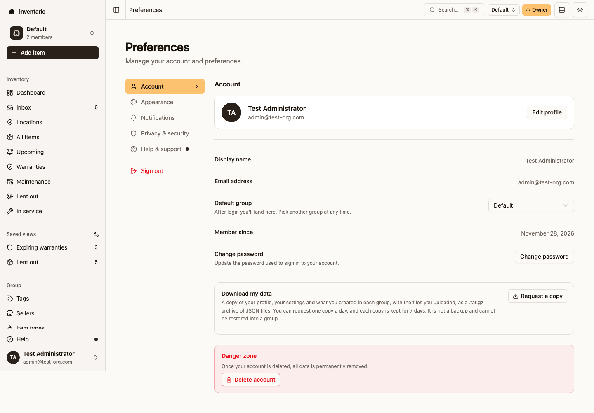
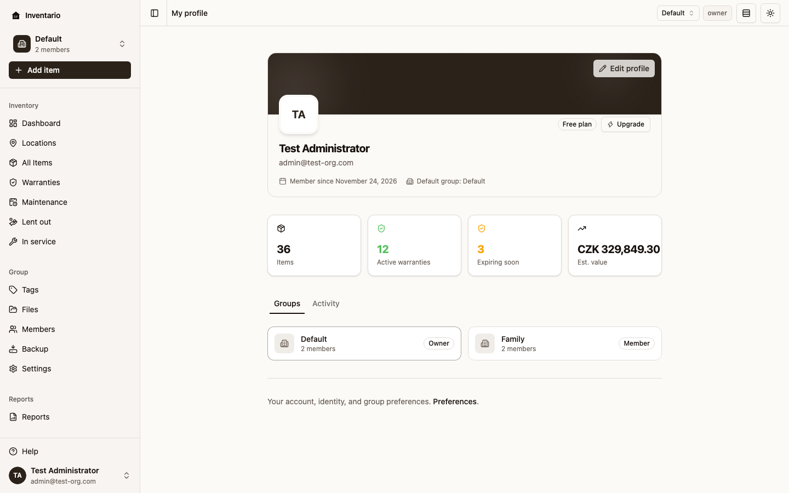

Everything about your account, your preferences, and keeping it secure lives in
one place. In the sidebar, under **Personal**, you'll find **Profile** (your
identity and groups at a glance) and **Preferences** (the settings hub). This
guide walks through the parts of **Preferences** that are about *you* rather than
your inventory: your profile details, how the app looks and speaks to you,
account security, sign-in methods, and where to get help.

The **Preferences** page has a left-hand menu with five sections — **Account**,
**Appearance**, **Notifications**, **Privacy & security**, and **Help &
support** — plus a **Sign out** shortcut at the bottom of that menu. Signing out
also removes the unsaved **Add item** input this browser kept for you (see
[Saved on this device](../items/#saved-on-this-device)).

## Your profile

Open **Profile** from the sidebar to see your identity card — your name, email,
a snapshot of your inventory (items, active warranties, expiring soon, estimated
value), and the groups you belong to.

To change your details, click **Edit profile** (it's on both the Profile page
and the **Account** section of Preferences). On the **Edit profile** page you
can:

1. Update your **Name**.
2. Choose your **Default group** — the group you land in after signing in.
   Switching groups with a group selector also makes that group your default,
   so you come back to the group you used last.
3. Click **Save changes**.

### Profile photo

The **Photo** section at the top of the **Edit profile** page sets the picture
shown next to your name. Click **Upload photo** (or the camera that appears when
you point at the picture) and choose a file. You can also click the picture on
your Profile page to pick one.

- The file must be a still **JPG, PNG or WebP** picture of at most **2 MB**.
  Animated pictures are refused.
- The photo is cropped to a square around its center and scaled down to at most
  512 × 512 pixels. A photo taken sideways on a phone is turned upright first.
- Everything stored in the file besides the picture itself, such as the camera
  model and the location where the photo was taken, is removed.
- The photo is visible to you, to the members of the groups you belong to,
  and to the administrators of the server on its admin pages. Nobody else can
  see it.
- A profile photo does not count toward any group's storage use.

To go back to your initials, click **Remove photo** under the picture and
confirm. Uploading a new photo replaces the old one. Deleting your account also
deletes your photo, and so does an administrator deleting it.

A couple of things to know:

- Your **email address** is shown but can't be edited here. To change the email
  on your account, contact support.
- You can **delete your account** yourself from the **Account** section's
  "Danger zone". Clicking **Delete account** opens a confirmation dialog where
  you type your email address to confirm and — for password accounts — re-enter
  your password. (Accounts that sign in only with Google or another social
  provider don't need to enter a password.) Deletion is **permanent and can't be
  undone**: it erases your account together with the inventory you own. The
  dialog links to [Download my data](#download-my-data), so you can take a
  copy first; a copy you requested is deleted with the account. A couple of
  cases are
  blocked with an explanation instead of deleting: if you're the **only owner**
  of a group that still has other members, hand ownership to someone else first;
  and if you created items, files, places or exports inside a group someone
  else owns, they need to be removed first. Both checks run before anything is
  deleted, so a blocked deletion leaves your account, your groups and your
  sessions as they were.
  [Tags](../tags/), [sellers](../sellers/) and [item types](../item-types/)
  you added to a shared group stay with the group and pass to its owner, so
  they don't block deletion and other members keep using them. So
  does the record of the [documents other systems sent](../documents-from-other-systems/)
  with one of your API tokens, together with the drafts those documents made.
  What you recorded on the items of a shared group stays there too and passes
  to its owner: the [history entries](../items/#the-item-detail-page) of your changes, loans,
  service records, supply links and maintenance schedules, and the restores
  and currency changes you ran. The item history then names the owner for the
  changes you made. The audit log of the server records, for each group, what
  passed to whom; the people who run the server can read it. Invites you
  created for a shared group stop working.
  Item reminders you set in a shared group are deleted with your account,
  since they only ever emailed you. So are the other
  [drafts of new items](../items/#drafts-of-a-new-item) you started there. A
  file saved with one of those drafts counts like any other file: one you
  uploaded needs to be removed first, and one another member uploaded stays in
  the group as a standalone file. Once deletion succeeds you're signed out
  immediately.

For more on groups, roles, and inviting people, see
[Groups & sharing](../groups-and-sharing/).

## Download my data

The **Download my data** card in the **Account** section of Preferences gives
you a copy of your own data, in a form you can read or take to another
service. Click **Request a copy**. Inventario prepares it in the background and
sends you an email when it is ready; the email links back to this card, not to
the file. While it is being prepared the copy shows as **Waiting** or
**Preparing**, and the list updates on its own; if the server restarts while
your copy is being prepared, it is prepared again, up to three times in all.
A copy still not ready two
hours after the request is no longer checked on its own; come back to the page
later to see it. When it is **Ready**, the
row shows its size and the day it is deleted, and **Download** saves it as
`inventario-personal-data-<date>.tar.gz`. A copy deleted since you opened the
page disappears from the list when you click **Download**, with a message
saying so.

The copy has:

- your profile: name, email address, when you joined, your default group and
  your profile photo;
- your preferences and your notification choices for each group;
- the groups you belong to, with the group name, your role and the day you
  joined;
- in each group, what you created there: items (including the ones in the
  [Trash](../trash/)) with their custom fields, the files you uploaded with
  their contents, loans, maintenance schedules, service records, reminders,
  supply links, open [drafts of new items](../items/#drafts-of-a-new-item),
  saved views, and the history entries you made.

Locations, areas, sellers, item types and tags appear by name on your items.
A history entry holds only the fields you changed, with the values you set,
not the values they replaced. Other members appear only as ids, and text you
typed is kept as you typed it. A file whose contents are no longer in storage
is listed without them and marked as missing. The files are
JSON, packed into a `.tar.gz` archive that any archive tool can open; a
`manifest.json` at the top says whose data it is and when it was made.

A few rules apply:

- You can request **one copy a day**. Until the next request is allowed, the
  button is disabled and the card says when you can request again; at that
  time the button is enabled again. This counts a request that failed, too.
- Each copy is **deleted 7 days** after it is ready, whether you downloaded it
  or not. A copy that could not be prepared shows as **Failed** and is removed
  from the list 7 days after the request; request a new one when the daily
  limit allows.
- The administrator of your Inventario server sees a copy that failed and can
  prepare it again for you. It then shows as **Waiting** again, you get the
  email when it is ready, and it is deleted 7 days after that. This is not a
  new request: the daily limit still counts from the request you made.
- Only you can see and download your copies. The download works only in the
  browser where you are signed in and clicked **Download**.
- A copy is **not a backup**. It holds only your part of each group, so it
  cannot be restored, and the
  [restore upload](../backup-and-restore/#import-a-backup-file) refuses it.
  To keep a copy of a whole group, make a [group backup](../backup-and-restore/)
  instead.
- An administrator who is signed in as you to help with a problem cannot
  request or download your copy.

## Appearance and preferences

The **Appearance** section controls how the app looks and formats things. Each
change applies immediately.

- **Theme** — choose **Light**, **Dark**, or **System** (follows your device's
  setting). Stored on this device.
- **Density** — **Comfortable** or **Compact**; Compact tightens headers and
  lists. Stored on this device.
- **Language** — switch the app's language between **English**, **Čeština**, and
  **Русский**. This also sets the language Inventario uses for emails it sends
  you.
- **Default view** — whether the Items list opens as **Photo cards**,
  **Compact cards**, or a **List**. A layout you pick from the Items list
  toolbar wins on that device until you change this setting there.
- **Preferred currency** — a saved preference for how currency should be
  displayed. It's stored on your account, but display conversion isn't wired up
  yet, so amounts still show in their stored currency for now.
- **Region & formatting** — how numbers, dates, and currencies are formatted
  (separators, symbol placement). This is independent of the UI language, so you
  can keep the interface in English while formatting numbers the Czech way, for
  example. Leave it on **Auto-detect (browser)** to follow your browser.

:::note
**Theme** and **Density** are stored on the device you're using, so each browser
or computer can have its own look. Your other preferences travel with your
account.
:::

The **Notifications** section lets you turn individual email/push reminders on
or off — warranty expiry, maintenance, loans, the reminders you set on items,
the weekly digest, price-drop alerts, and which channels to use. Under
**Warranty expiry**, **Maintenance reminders**, and **Loan reminders**, a
**Days before** field sets how far ahead you hear about each one. Those
reminders tie into your inventory; see
[Warranties, loans & maintenance](../warranties-loans-maintenance/#reminder-emails)
for what they cover and the limits of each field.

### Weekly digest

The weekly digest is one email on Monday morning summarising the week just gone.
Unlike the other notifications it is **off by default** — switch it on per group
in **Notifications** if you want it.

Each digest covers Monday to Sunday and lists, for every group you switched it
on for:

- how many items were added, how many were changed, and how many files were
  attached;
- warranties expiring in the next 30 days and maintenance due in the next 14,
  nearest first, for items that are In Use, unless the group
  [hides that section](../groups-and-sharing/#hide-sections-the-group-doesnt-use).

A few things worth knowing:

- **One email, not one per group.** If you switched the digest on for several
  groups, they all appear in the same message.
- **A quiet week sends nothing.** If none of your groups saw any activity, no
  digest is sent — there is nothing to report.
- **It never repeats.** You get at most one digest per week, even if the server
  restarts. If the server happens to be down on Monday morning, the digest
  arrives later that week rather than being skipped.
- Every digest carries a link straight back to the setting, so you can turn it
  off from the email.

## Change your password

Everything below lives in the **Privacy & security** section of Preferences,
except the password form, which is on the **Edit profile** page.

1. Go to **Edit profile** (from **Profile**, or from **Account → Change
   password** in Preferences).
2. Click **Change password** to expand the form.
3. Enter your **Current password**, then a **New password**, and confirm it. A
   strength meter helps you pick something strong.
4. Click **Change password** to save.

:::caution
When you change your password, Inventario signs you out **everywhere** — every
device has to sign in again with the new password — and you'll be returned to
the sign-in page. It also revokes all your [API tokens](#api-tokens).
:::

:::tip
If you signed up with Google, GitHub or single sign-on and never set a
password, the **Edit profile** page shows a **Set password** form instead, so
you can add one.
:::

## Two-factor authentication

Two-factor authentication (2FA) adds a second step at sign-in: a six-digit code
from an authenticator app such as Google Authenticator, 1Password, or Authy. The
**Two-factor authentication** row in **Privacy & security** shows whether it's
**Active** or **Inactive**.

### Set it up

1. In **Privacy & security**, click the **Two-factor authentication** row.
2. **Scan the QR code** with your authenticator app. Can't scan? Use the
   **Manual setup key** shown beneath it.
3. Enter the **Verification code** from your app and click **Verify & enable**.
4. Inventario shows your **backup codes**. Save them somewhere safe — each one
   is single-use and you won't see them again. Use **Copy codes** if you like.
5. Tick **I have saved these codes somewhere safe**, then click **Done**.

:::caution
Your backup codes are shown only once. Store them somewhere safe before you
finish setup — if you lose your authenticator and have no backup codes left,
you'll need to contact support to regain access.
:::

### Use a backup code

If you can't reach your authenticator at sign-in, you can enter one of your
backup codes instead of the six-digit code. Each backup code works once. If
you're running low, the **Two-factor authentication** row warns you so you can
set 2FA up again to get a fresh set.

### Turn it off

1. In **Privacy & security**, click the **Two-factor authentication** row (it
   now opens the disable dialog).
2. Enter your **Password** and a current **Authenticator code** — or switch to
   **Use a backup code instead** and enter a backup code.
3. Click **Disable**.

Turning 2FA off also revokes all your [API tokens](#api-tokens).

## Active sessions

Open **Active sessions** from **Privacy & security** to see every device and
browser currently signed in to your account. Each card shows the browser and
operating system, when the session was last used and created, and a partial IP
address. Your current device is marked **This device**.

- To sign out a single device, click **Revoke** on its card and confirm.
- To sign out everything except where you are now, use **Sign out all other
  sessions** (shown when you have other sessions) and confirm. Your current
  session stays active.

:::tip
This is a good thing to check if you ever see unfamiliar sign-in activity.
:::

## Login history

Open **Login history** from **Privacy & security** for a recent, reverse-order
list of sign-in attempts — both successful and failed — so you can spot anything
suspicious. Each entry shows the outcome (for example **Success**, **Failed:
bad password**, or **MFA required**), the sign-in method, the time, and the IP
address and device where available.

If there have been several failed attempts (more than three) in the last seven
days, a banner at the top points it out. If you don't recognise the activity, change your password
and revoke any sessions you don't trust.

## API tokens

An API token lets a script or another app use Inventario as you, without your
password: a Home Assistant card that shows what is lent out, a nightly job that
exports a list, another app that adds a purchase. Open **API tokens** from
**Privacy & security** to create and revoke them. The
[API tokens for scripts](../api-tokens/) page explains how a script sends one
and which endpoints it can use.

### Create a token

1. Click **New token**.
2. Give it a **Name** you will recognise later, for example the app that uses
   it.
3. Choose its **Access**:
   - **Read only** can list and view data but not change it.
   - **Read and write** can also create, change and delete.
4. Under **Group**, keep **All my groups** or pick one group. A token limited to
   one group cannot reach any other.
5. Under **Expires**, pick **30 days**, **90 days**, **1 year** or **No
   expiry**.
6. Confirm it is you: enter your **Current password**, and the code from your
   authenticator app (or a backup code) if two-factor authentication is on.
7. Click **Create token**, then **Copy token** and store it where the script
   can read it. Click **Done**.

:::caution
The token is shown only once, when you create it. Inventario keeps only a
fingerprint of it and cannot show it again. If you lose it, revoke it and
create a new one.
:::

### What a token can do

A token acts as you, with your current role in each group it can reach: if you
are a viewer in a group, a **Read and write** token cannot change anything there
either, and if you leave a group, the token loses it too; a token limited to
that group is revoked. It works only on the
data inside groups (items, locations, areas, files, tags, loans, services,
maintenance, exports and the like), and it can read the list of your groups,
each group's details, and its members and their photos.

A token cannot sign in, change your profile, password or two-factor settings,
see or end sessions, create or revoke tokens, see or accept invitations,
create, leave or manage groups or members, or reach anything in the admin
area. Those stay with you in the browser.

### The token list

Each card shows the token's name, its access, the first characters of the token
so you can tell tokens apart, the group it is limited to (or **All your
groups**), when it was last used, when it expires, and when you created it.
**Last used** is updated at most every five minutes. An expired token stays on
the list, marked **Expired**, until you revoke it.

To revoke a token, click **Revoke** on its card and confirm. Anything that uses
it stops working at once.

### When tokens stop working on their own

Besides expiring, all your tokens are revoked when:

- you change your password, or reset it through a password-reset email;
- you turn off two-factor authentication;
- an administrator blocks your account, deactivates it, or signs you out of
  every session.

A token you are creating at the moment one of these happens is not created.
Unblocking an account does not bring its tokens back; create new ones. Tokens
are deleted with your account, and a token limited to one group is deleted when
that group is deleted.

:::note
An administrator who is signed in as you, for example to help with a problem,
can see your tokens but cannot create or revoke them.
:::

## Connected accounts

If your Inventario server has sign-in with Google, GitHub or a single sign-on
provider enabled, a **Connected accounts** panel appears in **Privacy &
security**. It lets you link those providers so you can sign in without a
password. A single sign-on provider appears under the name your server gave it,
for example **Authelia**.

- To link a provider, click **Link Google** / **Link GitHub** and complete the
  sign-in with that provider. Once linked, the row shows the provider's email
  and when you linked it.
- To unlink, click **Unlink** and confirm. Inventario lists the sign-in methods
  you'd have left so you can be sure you won't lock yourself out.

:::caution
You can't unlink your **only** remaining way to sign in. If a provider is your
last method, set a password first (or link another provider) before unlinking it.
:::

:::note
If your server hasn't enabled any sign-in providers, this panel doesn't appear.
:::

## Help & support and feedback

The **Help & support** section gives you five quick links:

- **Documentation** — opens the user guide in a new tab.
- **Restart product tour** — walks you through the sidebar again, the same as
  **Restart product tour** in the user menu. The tour needs a group and a window
  wide enough to show the sidebar; without them the row is greyed out and says
  what is missing.
- **Keyboard shortcuts** — opens the full list of shortcuts (you can also press
  `?` anywhere in the app).
- **What's new** — opens the [What's new](#whats-new) page. The badge next to
  it shows the version you run, such as `v0.2`.
- **Contact support / share feedback** — opens a form to ask a question, report
  a bug, or suggest a feature. The same form is your channel for reaching the
  team directly.

### What's new

The **What's new** page lists the releases of Inventario up to the one your
server runs, newest first. Each release shows its date and its changes, grouped
under headings such as **Added**, **Changed** and **Fixed**. The release notes
are in English. Links in them open on GitHub in a new tab. You can also open the
page directly at `/whats-new`.

When your server has a release you haven't read about, a dot appears next to
**What's new**, on the **Help & support** tab, and on **Help** in the sidebar.
Opening the page clears it. Inventario remembers the newest release you have
seen on your account, so the dot stays away on your other devices too. If you
have never opened the page, the dot shows once. The dot needs a group: until
you create or join one, it doesn't appear, though the page itself opens.

If your server runs a development build rather than a release, the page says so
and lists the releases the build contains.

System administrators also see an **Operators** section at the end of a
release: changes to the Helm chart, command-line flags, environment variables
and other things that matter to whoever runs the server. Other users don't see
it, and a release that changed only those things brings them no dot. If they
open the page anyway, such a release tells them it changed only how the server
is installed and run.

---

See also: [Getting started](../getting-started/) ·
[Groups & sharing](../groups-and-sharing/) ·
[Backup & restore](../backup-and-restore/)
